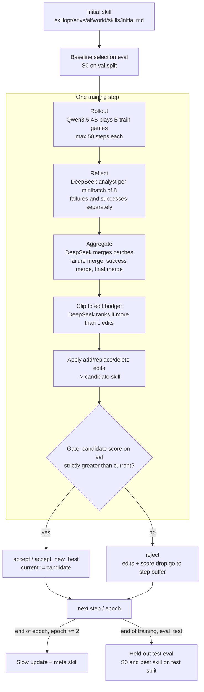

# Baseline Architecture: SkillOpt on ALFWorld

Verified against upstream `microsoft/SkillOpt` at commit **`1a44050`** (package
version 0.2.0) and the paper *SkillOpt: Executive Strategy for Self-Evolving
Agent Skills* (arXiv 2605.23904, PDF v2). Line numbers refer to that commit.
Status labels: **Verified** = read in source; **Paper** = stated in the paper;
**Unknown** = not determinable from either.

## 1. The loop in one picture

**Takeaway:** the target model only *acts*; the optimizer model only *reads
trajectories and writes edits*; the gate is the only thing that decides
whether an edit survives, and it uses the native benchmark score.

## 2. How ALFWorld rollouts are executed (Verified)

| Piece | Location | What it does |
|---|---|---|
| Adapter | `skillopt/envs/alfworld/adapter.py` | `ALFWorldAdapter.rollout` (319-362) runs a batch in chunks of `env.workers` (=8) simulators (`_run_batch`, 370-425). **Resumes** by returning an existing `results.jsonl` if present (329-339). |
| Episode loop | `skillopt/envs/alfworld/rollout.py:148-338` | Per step: build prompt, one `chat_target` call per active env (thread pool, `max_api_workers`), parse `<action>…</action>`, `env_manager.step`, record step. |
| Prompt | `skillopt/envs/alfworld/prompts/rollout_no_history.md`, `rollout_with_history.md` via `vendor/env_manager.py:82-111` | Single user message: skill block (`## Skill Knowledge`, rollout.py:48-57) + task + last 2 observation/action pairs + admissible actions. Fixed system prompt (rollout.py:231). Not a multi-turn chat. |
| Simulator | `vendor/alfworld_envs.py` → `alfworld.agents.environment.get_environment("AlfredTWEnv")`, config `vendor/config_tw.yaml` | TextWorld version of ALFRED; game files are `$ALFWORLD_DATA/json_2.1.1/.../game.tw-pddl`. |
| Score | rollout.py:293, 319-320 | `hard = soft = 1 if infos["won"] else 0`. Binary success, no partial credit. |
| Splits | `data/alfworld_path_split/{train,val,test}/items.json` | 39 train (from `train/`), **18 val** (from `valid_seen/`), 134 test (from `valid_unseen/`). Relative paths resolved against `$ALFWORLD_DATA` (rollout.py:66-76). Selection uses `val`; `sel_env_num: 0` = all 18; `N>0` = first N in file order (all one task type for small N; `datasets/base.py:503-505`). |

### 2a. Selection-split provenance: 18 vs. 140

**Verified (repo):**
- The split files are `data/alfworld_path_split/{train,val,test}/items.json`,
  added in upstream commit `181d71b` ("Release data split manifests", 2026-06-01)
  with no further explanation. `data/README.md` and `ckpt/README.md` present
  them as the paper-aligned manifests.
- Contents: train = 39 games from `json_2.1.1/train/` (out of ~3.5k);
  val = **18** games from `valid_seen/` (17 distinct task directories; two
  trials of one task); test = **134** games from `valid_unseen/`. All three
  are sorted by task type.
- `split_manifest.json` says the lists come from `split_train.json`,
  `split_val.json` and `split_test.json`, "generated by alfworld-download".
  As far as I know, `alfworld-download` does not produce files with those
  names. This claim gets checked after the data is downloaded.
- The 39/18/134 counts are not what SkillOpt's own ratio splitter produces:
  a 2:1:7 split of 191 items gives 38/19/134.
- Selection uses `val` (`valid_seen` aliases to it); `sel_env_num: 0` means all 18.

**Paper:** "39 training tasks with 140 selection and 134 test environments"
(Sec. 4). ALFWorld's TextWorld `valid_seen` and `valid_unseen` sets are
conventionally 140 and 134 games. So the paper's test set matches the repo
(all of `valid_unseen`), and the paper's selection set appears to be all of
`valid_seen`, while the repo ships an 18-game subset.

**Verified (data census, setup_env job 64323909):** the downloaded
`json_2.1.1` has train 3553, **valid_seen 140**, **valid_unseen 134** games.
The paper's "140 selection" therefore equals all of `valid_seen`, and its
"134 test" equals all of `valid_unseen` (the repo's test split). The
`split_{train,val,test}.json` files the manifest cites do **not** exist in the
`alfworld-download` output. The 18 val items sit at scattered positions in
sorted `valid_seen` (0, 1, 10, 27, …, 122), not a prefix.

**Unknown:** why the released selection split is an 18-game subset and how it
was sampled. No upstream issue mentions it (searched 2026-10-19). Proposal: decide before full runs whether to
(a) keep 18 (repo-faithful), (b) materialize a 140-game selection split from
`valid_seen` (paper-faithful; about 8× the gate cost), or (c) ask upstream.

### 2b. Silent fallbacks and how far they can be detected

**Verified:** if the target call raises, returns empty text, or omits the
`<action>` tag, `rollout.py` replaces the response with one of three fixed
strings and plays `look` (rollout.py:238-245, 261-263). The strings are:

| Recorded `model_response` (exact) | Cause |
|---|---|
| `<think>empty model response</think><action>look</action>` | empty text |
| `<think>missing action tag</think><action>look</action>` | text without `<action>` |
| `<think>error</think><action>look</action>` | exception (backend failed after its internal retries, or worker future failed) |

`agent_ok` is hard-coded `True`, so a broken endpoint looks like a very bad
skill rather than a crash. `research/summarize_run.py` classifies each step by
**exact** equality with these strings (a test checks they still appear in
`rollout.py`), so a genuine `look` with the model's own reasoning is counted
separately.

**What cannot be recovered from the trajectory:**
- The original model text in the missing-tag case, and the exception message
  in the error case. `rollout.py` discards both.
- Which of the two exception paths fired.
- Backend retries that eventually succeeded. `qwen_chat` retries up to 5 times
  with backoff and logs nothing.
- A model that emits a sentinel string verbatim would be misclassified. That
  is implausible, but possible in principle.

**Executed vs. recorded action:** the env manager executes a *lowercased*
copy of the first `<action>…</action>` span (`vendor/alfworld_projection.py`),
while the trajectory records `_extract_action` (same span, original case).
The projection also computes an `is_action_valid` flag (missing `<think>`
tags or CJK characters), but nothing records it or uses it for scoring.
`summarize_run.py` recomputes it as `format_invalid`.

**Proposal (not for the baseline):** for the failure-localization research,
add opt-in instrumentation behind a config flag, off by default. It would
store the raw response, the exception type and message, the retry count, the
executed action, and the validity flag per step, without changing what the
agent does.

## 3. How the target and optimizer models are configured (Verified)

Backends are chosen **per role**, so mixing a hosted optimizer with a local
target needs no code change.

- Config keys → flat keys: `skillopt/config.py:45-50, 98-143`.
- Role resolution: `skillopt/engine/trainer.py:480-` (`_resolve_role_backends`);
  an explicitly set `optimizer_backend` / `target_backend` wins over `model.backend`.
- Backend configuration: `trainer.py:782-870` (`set_*_deployment`,
  `configure_qwen_chat`, `configure_openai_compatible`). Dispatch per call:
  `skillopt/model/__init__.py` (`chat_optimizer`, `chat_target`).

| Role | Backend | Module | Key settings and defaults |
|---|---|---|---|
| Target: Qwen3.5-4B | `qwen_chat` | `skillopt/model/qwen_backend.py` | Raw HTTP POST to `{base_url}/chat/completions`. Env `TARGET_QWEN_CHAT_{BASE_URL,API_KEY,MODEL,TEMPERATURE,MAX_TOKENS,THINKING_MODE}`. Temperature defaults to **0.7** (`_resolve_temperature`, 136-149); `max_tokens` = min(caller 16384, 8000). Thinking mode: `server_default` omits `chat_template_kwargs` and warns; `disabled` sends `enable_thinking: false` (289-293). `reasoning_effort` ignored. |
| Optimizer: DeepSeek | `openai_compatible` | `skillopt/model/openai_compatible_backend.py` | OpenAI SDK, `base_url` + `api_key`; env `OPTIMIZER_OPENAI_COMPATIBLE_{BASE_URL,API_KEY,MODEL,MAX_TOKENS,TEMPERATURE}`. Sends `model`, `messages`, `max_tokens` = min(caller, 8000 default), temperature only if set. **`reasoning_effort` is dropped** (`set_reasoning_effort` is a no-op), no `extra_body`. Returns `message.content` only; `resp.model` is **not logged**. If `optimizer_model` is empty the default is `gpt-4o-mini` (`model/common.py:33`). |

## 4. How DeepSeek connects using the existing backend

No source change needed. Our research config
(`configs/research/alfworld_qwen35_deepseek.yaml`) sets
`optimizer_backend: openai_compatible`,
`optimizer_openai_compatible_base_url: https://api.deepseek.com`, and the job
passes `--optimizer_model <id>` and exports
`OPTIMIZER_OPENAI_COMPATIBLE_API_KEY` from a cluster-only secrets file.

Open points (**Unknown** until checked from a compute node):
- The exact API model id for "DeepSeek V4.1 Flash" — `check_compute.sbatch`
  lists `GET /models` and records `resp.model` for one call.
- Whether that model thinks by default and how its reasoning is controlled.
  The backend cannot send reasoning controls, so we get the provider default;
  we log `has_reasoning_content` in preflight. Reasoning tokens (if any) count
  against `max_tokens`, which is why the config raises the backend cap from
  8000 to the caller's 16384.

## 5. How skill edits are generated and validated (Verified)

1. **Reflect** — `skillopt/gradient/reflect.py:485-648`. Results split into
   failures / successes, shuffled by batch seed, grouped by `minibatch_size`=8,
   one optimizer call per group. Prompts: `skillopt/envs/alfworld/prompts/analyst_error.md`
   and `analyst_success.md` (env-specific overrides generic). The analyst sees
   the current skill, edit budget, this epoch's step buffer (incl. rejected
   edits), the meta skill, and the trajectories (`conversation.json`). Output
   truncated to L edits (360).
2. **Aggregate** — `skillopt/gradient/aggregate.py:156-275`, prompts
   `skillopt/prompts/merge_failure.md`, `merge_success.md`, `merge_final.md`.
   Failure merge wins conflicts. On merge failure, falls back to concatenation.
3. **Clip** — `skillopt/optimizer/clip.py:25-109`, `ranking.md` only if merged
   edits exceed the budget L. L follows `lr_scheduler: cosine` from 4 to 2
   (`optimizer/scheduler.py`); with one total step L = 4.
4. **Apply** — `skillopt/optimizer/skill.py:165-186` (append / insert_after /
   replace / delete); edits to protected slow-update / appendix regions skipped.
5. **Gate** — `skillopt/evaluation/gate.py:200-225`, called at `trainer.py:1583`.
   Candidate is rolled out on the full val split (cached by skill hash). Metric
   `hard` (`trainer.py:1089`). **Strictly greater than current → accept**
   (and `accept_new_best` if also > best); ties and drops → reject. The
   baseline "current" score is S0 on the same split (`trainer.py:1129-1159`).
6. **Slow update / meta skill** (epoch ≥ 2) — `skillopt/optimizer/slow_update.py`,
   `meta_skill.py`, `trainer.py:1767-2197`. By default the slow-update block is
   force-accepted (`slow_update_gate_with_selection: false`).

## 6. Where outputs are stored (Verified)

Everything goes under `out_root` (we set `$RUN_DIR/skillopt`):

| Artifact | Path |
|---|---|
| Resolved config (secrets redacted) | `config.json` |
| Skill snapshots | `skills/skill_v0000.md`, `skills/skill_v{step:04d}.md`, `best_skill.md` |
| Baseline selection rollout | `selection_eval_baseline/{results.jsonl, predictions/<id>/conversation.json}` |
| Train rollout | `steps/step_XXXX/rollout/{results.jsonl, predictions/...}` |
| Edit proposals | `steps/step_XXXX/patches/minibatch_{fail,succ}_NNN.json`, `merged_patch.json`, `ranked_edits.json` |
| Candidate + application report | `steps/step_XXXX/candidate_skill.md`, `edit_apply_report.json` |
| Gate rollout | `steps/step_XXXX/selection_eval/...` |
| Gate decision + per-stage tokens | `steps/step_XXXX/step_record.json`, `history.json` (fields `action`, `selection_hard`, `current_score`, `best_score`, `tokens`) |
| Run summary + token totals | `summary.json` (`token_summary`) |
| Test evaluation | `test_eval_baseline/`, `test_eval/`, `test_eval_final/` |

**Not recorded by SkillOpt:** git commit, Slurm job, vLLM settings, resolved
optimizer model id, stdout logs (no log file). Our wrapper adds these
(`manifest.json`, `job.log`, `vllm.log`, `preflight.json`, `pip_freeze_*.txt`,
`run_summary.json`, `sacct.txt`); see `BASELINE_SETUP.md`.

**Reuse hazard:** rollouts, patches and history resume from whatever is in
`out_root`. Our wrapper always creates a fresh, unique run directory.

## 7. Dependencies for the baseline

| Component | Needs | Notes |
|---|---|---|
| Controller (SkillOpt + ALFWorld) | Python ≥ 3.10; `openai`, `pyyaml`, `numpy`, `openpyxl`, `azure-identity`, `azure-core`, `httpx` (core); `alfworld` (→ `textworld[pddl]`), `gymnasium`, `omegaconf`, `json_repair` | `alfworld` base install is enough for TextWorld; `[full]` (THOR, torch, detectors) is not needed. `torch` is optional (`vendor/env_base.py:12-18`). |
| ALFWorld data | `alfworld-download` → `$ALFWORLD_DATA/json_2.1.1`, `logic/alfred.{pddl,twl2}` | ~GBs of small files. |
| Target server | `vllm` (we pin 0.25.1, which registers `Qwen3_5ForConditionalGeneration`), CUDA GPU | Qwen3.5-4B is an image-text-to-text checkpoint; we serve text only (`--limit-mm-per-prompt` image/video 0). |
| Optimizer | Outbound HTTPS from the compute node to `api.deepseek.com`, API key | |

## 8. Code vs. published method

| Item | Paper | Code default (1a44050) | Consequence for us |
|---|---|---|---|
| Epochs / batch / minibatch / merge batch / analysts | 4 / 40 / 8 / 8 / 16 (Sec. 4) | same (`_base_/default.yaml`) | batch 40 > 39 train items; paper says batch "scaled accordingly" for ALFWorld but gives no value (**Unknown**). |
| Edit budget | 4 → 2 cosine | same | — |
| Gate | strict `>`, ties rejected (Sec. 3.5) | same (`gate.py:200`) | — |
| **Selection split size** | **140** valid_seen environments (Sec. 4) | **18** (`data/alfworld_path_split`) | One episode = 5.6 points; gate much noisier than the paper's. Provenance in §2a. Smoke uses 18; decide before full runs. |
| **Slow update gated** | yes (Sec. 3.6) | `slow_update_gate_with_selection: false` (force-accepted into the current skill; `trainer.py:2039-2063`) | Smoke keeps the upstream default (epoch 1 only injects an empty placeholder). Decide paper-aligned setting before larger runs. |
| **Reflection rounds** | "up to three refinement rounds" per minibatch | single pass; CHANGELOG (Unreleased, #213/#219) says `max_analyst_rounds` "was parsed and logged but never reached reflection" and retires it | Smoke keeps upstream (single pass). **Interpretation:** the released code, and likely the paper's runs, used one pass. A paper-aligned multi-round mode would be new code. |
| Rejected-edit buffer | per epoch | per epoch (`trainer.py:1187`), analysts only | — |
| Qwen thinking mode / temperature | not stated | server default + 0.7 | We pin `disabled` (repo comment says published non-thinking numbers) and record 0.7. |
| Optimizer for Qwen runs | frontier model (GPT-5.5 family), not explicit | — | Our DeepSeek optimizer is a deliberate deviation; numbers are not expected to match Table 1 (Qwen3.5-4B: 30.6 no-skill → 81.3 SkillOpt). |
| Soft gate, semantic density, skill-aware reflection | not in paper | present, off by default | Leave off. |

Other quirks (Verified): `--steps_per_epoch` is parsed but overwritten
(`trainer.py:935`); `run_alfworld_batch(temperature=0.4)` is unused;
`env.exec_timeout` is not applied to ALFWorld calls; `eval_only.py --split all`
likely fails on ALFWorld (concatenates frozen dataclasses), so always pass an
explicit split; `ALFWorld` hidden-reference context is never shown to the
analyst (`attach_reference_context` unused).
