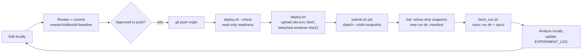

# Baseline Setup: Local Development, Cluster Execution

Machine-specific values (SSH alias, Slurm account, partitions, absolute
paths) live only in the git-ignored `research/cluster/site.env`; the tracked
template is `research/cluster/site.env.example`. Settings that define the
experiment (model id and revision, vLLM version, Qwen request settings) are
tracked in `research/cluster/experiment.env`. This document uses the variable
names from those files.

## 1. Where things live

| What | Local | Cluster |
|---|---|---|
| Source of truth | this checkout, branch `research/alfworld-baseline` | — |
| Remotes | `origin` = research fork (**public**), `upstream` = `microsoft/SkillOpt` | — |
| Deployment clone (fetch only, never edited) | — | `$REPO_DIR` |
| Immutable code snapshots | — | `$SNAPSHOT_ROOT/<sha12>` (detached git worktrees) |
| Run outputs | `$LOCAL_RUNS/<run>` (fetched copies, outside git) | `$RUN_ROOT/<YYYYmmdd-HHMMSS>_<name>_<jobid>` |
| Slurm stdout | — | `$PROJECT_ROOT/slurm_logs/%x-%j.out` |
| Model weights | — | `$HF_HOME` (persistent project storage, not home) |
| ALFWorld data | — | `$ALFWORLD_DATA` |
| Conda envs (new) | — | `$CTL_ENV` (controller), `$LSO_VLLM_ENV` (server) |
| Private site settings | `research/cluster/site.env` | `$CLUSTER_SITE_ENV` (uploaded by `deploy.sh`) |
| Secrets | none | `$SECRETS_FILE` (chmod 600) |

The project storage is persistent but not necessarily backed up; important
runs are fetched locally. The home quota is small, so pip / vLLM / HF caches
are redirected to project storage (`lib.sh:load_site`).

## 2. Cluster facts used by this setup

Verified on the login node with read-only commands (2026-10-19); concrete
values are recorded in the private `site.env`.

| Item | Finding |
|---|---|
| Slurm | Two accounts available, no per-user limits; one chosen by the user. GPU partition with 8 × A40 (48 GB) nodes; standard CPU partition; 14-day max walltime. |
| Modules | CUDA 12.x–13.x and cuDNN modules exist; not needed (vLLM wheels bundle CUDA). |
| Conda | Miniforge with envs on project storage. |
| Existing vLLM | Another project's env has vllm 0.25.1 / torch 2.11.0 / transformers 5.14.1 and registers `Qwen3_5ForConditionalGeneration`. **Not used or modified**; we create our own pinned env. |
| Qwen3.5-4B | Not cached yet. HF revision `851bf6e806ef…` (image-text-to-text checkpoint). |
| ALFWorld data | Not present. |
| DeepSeek API | Reachable from the login node (HTTP 401 without key, as expected). **Compute-node access not yet verified.** |
| Proxy | No `*_proxy` variables on the login node; jobs set `NO_PROXY=127.0.0.1,localhost` anyway. |

## 3. The deployment cycle



Each experiment runs from a worktree pinned to one commit, so fetching code
for the next experiment can never change files under a running job. Snapshots
are never edited; a fix is a new commit and a new snapshot. The cluster clones
the fork over HTTPS (public), so it needs no GitHub credentials.

### Commands

```bash
research/deploy.sh --check                 # read-only: local + cluster readiness
research/deploy.sh                         # deploy HEAD (must be committed and pushed)

research/submit.sh setup_env               # CPU, once
research/submit.sh run_tests               # CPU, focused pytest
research/submit.sh check_compute           # CPU, DeepSeek from a compute node (1-2 tiny calls)
STAGE=vllm research/submit.sh smoke        # 1 A40, Qwen endpoint only
STAGE=rollout ROLLOUT_EPISODES=1 OPTIMIZER_MODEL=<id> research/submit.sh smoke
STAGE=train OPTIMIZER_MODEL=<id> research/submit.sh smoke HEAD -- --time=<from rollout measurement>

research/fetch_run.sh <jobid>
```

`submit.sh` takes the account from `site.env`, uses `GPU_PARTITION` for
`smoke` and `CPU_PARTITION` otherwise, and appends each submission (time, job
id, stage, commit) to `docs/research/jobs.tsv`.

## 4. One-time manual step: the DeepSeek key

On the cluster, outside any repository:

```bash
mkdir -p ~/.config/lean_skillopt && chmod 700 ~/.config/lean_skillopt
cat > ~/.config/lean_skillopt/secrets.env    # paste: DEEPSEEK_API_KEY=...   then Ctrl-D
chmod 600 ~/.config/lean_skillopt/secrets.env
```

Jobs refuse to read it unless its mode is 600. After `check_compute` lists the
models, pin `OPTIMIZER_MODEL` in `experiment.env` (tracked, since it defines the
experiment).

## 5. What each job does

| Job | Resources | Purpose |
|---|---|---|
| `setup_env` | CPU, 4 cores, 16 GB, ≤2 h | Create the two new envs (installs run with the env activated on `PATH`; `alfworld` builds `fast-downward-textworld` from source with system cmake/gcc; envs it creates get a marker and are resumed if incomplete; envs it did not create are never touched), download Qwen3.5-4B at the pinned revision, `alfworld-download`, import check, check all 191 split gamefiles exist, write `alfworld_data_census.json` (game counts per ALFWorld split, presence of the `split_*.json` files the manifest cites, positions of the 18 val items in `valid_seen`). |
| `setup_vllm_env` | CPU, 4 cores, 32 GB, ≤2 h | Create **only** the vLLM env for `LSO_VLLM_VERSION` at `LSO_VLLM_ENV` (one env per version; others untouched), then verify the installed code: version pin, torch/CUDA build, `UniProcExecutor` uses `file://` rendezvous, Qwen3.5 registered, native-sampler switch present, and every `vllm serve` flag we pass (`vllm_env_check.json`, `vllm_serve_help.txt`). |
| `run_tests` | CPU, 2 cores, 8 GB, ≤30 min | Research-config guards, fallback classifier, gate / ALFWorld path / backend tests. |
| `check_compute` | CPU, 1 core, 4 GB, ≤15 min | Outbound HTTPS from a compute node; list DeepSeek models; if `OPTIMIZER_MODEL` is listed, two tiny calls **through SkillOpt's `openai_compatible` backend** (configured from the research YAML): plain text, and a JSON edit parsed by SkillOpt's `extract_json`. Records resolved model, `reasoning_content` presence, whether SkillOpt's returned text excludes reasoning, full usage, and estimated cost. |
| `smoke STAGE=vllm` | 1 A40, 8 cores, 64 GB, ≤1 h | Start vLLM, verify loopback-only listeners, send one real ALFWorld prompt through SkillOpt's `qwen_chat` backend, require an `<action>` tag. |
| `smoke STAGE=rollout` | same | `ROLLOUT_EPISODES` (default 1) ALFWorld episodes via `eval_only.py`; **no DeepSeek calls**; vLLM throughput from `/metrics`, HTTP status counts from `vllm.log`. |
| `smoke STAGE=train` | same; walltime set from the rollout measurement | DeepSeek preflight, then one original SkillOpt step (see §7). |

All smoke stages sample GPU memory and utilization every 5 s (`gpu_usage.csv`; peak/mean in `run_summary.json → gpu_usage`).

### Files in every run directory

`manifest.json` (sanitized; see below), `experiment.env` (copy of the
tracked experiment settings), `job.log`,
`vllm.log`, `vllm_models.json`, `vllm_listeners.txt`,
`vllm_startup_seconds.txt`, `vllm_metrics_{before,after}.prom`,
`preflight.json`, `pip_freeze_{ctl,vllm}.txt`, `skillopt/` (SkillOpt's own
`out_root`), `run_summary.json`. `fetch_run.sh` adds `sacct.txt` and the Slurm
`.out` file.

**What is never written to a run directory:** `site.env` and `secrets.env`.
The manifest records the commit, run id, Slurm job id / partition /
CPU / memory / GPU count / time limit, GPU model and driver, model id and
revision, Qwen request settings, the vLLM command line, and the requested
optimizer model. It omits the Slurm account, node names and absolute paths,
and represents the private `site.env` only by its SHA-256
(`site_env_sha256`), so a change in site settings between runs is detectable.
Every job ends with `assert_run_dir_clean`, which fails the job if a
`site.env` / `secrets.env` file is present or if the DeepSeek key or the
per-job vLLM key appears in any run file (values are never printed).

**Still present (private artifacts):** SkillOpt's own outputs contain
absolute cluster paths (`skillopt/config.json` → `out_root`;
`results.jsonl` → `gamefile`, resolved against `$ALFWORLD_DATA`), and tool
output in `job.log` / `vllm.log` (conda, pip, Hugging Face) can contain paths
and the node name. Treat run directories as private; review before sharing.

## 6. vLLM networking

| Channel | Binding | Source |
|---|---|---|
| OpenAI HTTP API | `--host 127.0.0.1 --port <random free port>` | vLLM CLI |
| torch.distributed rendezvous address (single-GPU executor) | `tcp://<VLLM_HOST_IP>:<port>` (`uniproc_executor.py`); we set `VLLM_HOST_IP=127.0.0.1`, so **clients** connect over loopback | vLLM 0.25.1 source |
| **vLLM ≥ 0.28.0 rendezvous** | `file://<TMPDIR>/vllm_dist_<uuid>` → torch `FileStore`, **no TCP listener** (PR #50999; `UniProcExecutor._distributed_args`, unless ROCm AITER custom all-reduce). We give the vLLM process a private `mktemp -d` dir (mode 700) as `TMPDIR`, so the store file and engine IPC sockets are not in the node's shared `/tmp`; `check_vllm_rendezvous` records the method and location (`vllm_rendezvous.json`) | v0.28.0 source (tag and installed copy) |
| torch c10d **TCPStore server** (vLLM 0.25.1 rendezvous store) | **all interfaces** (`0.0.0.0`, observed in job 64330104). Created by `torch.distributed.rendezvous._create_c10d_store` (`is_master=True` on rank 0). `TCPStoreOptions` (torch 2.11 header) has a `port` but **no bind address**; only `masterListenFd` (a pre-bound socket) restricts it, and the `tcp://` rendezvous path does not expose it | torch 2.11 source/header + job 64330104 |
| Gloo CPU process groups (vLLM creates one per parallel dimension) | hostname's interface by default (7 node-IP listeners in 64330104); **`GLOO_SOCKET_IFNAME=lo`** binds them to loopback | torch docs; string present in `libtorch_cpu.so`; to verify in the next job |
| API server ↔ engine core | local IPC (Unix socket) when single-node (`get_engine_client_zmq_addr(local_only=True)`) | same |

**Sampler:** `VLLM_USE_FLASHINFER_SAMPLER=0` (from `LSO_VLLM_USE_FLASHINFER_SAMPLER` in
`experiment.env`) selects vLLM's native PyTorch top-k/top-p sampler. FlashInfer's
sampler JIT-compiles a CUDA module at startup and needs `nvcc`, which the job
does not provide (job 64329002). The sampling semantics are the same; the
kernel and RNG path differ. `lib.sh:check_vllm_sampler` reads `vllm.log`
and fails the job unless the native sampler was selected. The setting is
recorded in `manifest.json → target.vllm_env` and is shared by all arms.
Project variables use the `LSO_` prefix; only real vLLM settings
(`VLLM_HOST_IP`, `VLLM_USE_FLASHINFER_SAMPLER`, `VLLM_API_KEY`) reach vLLM.

`lib.sh:check_vllm_listeners` lists every TCP listener in vLLM's process
session and classifies it with `research/classify_listeners.py`. **pass**
means every listener is loopback. **unresolved** means the only non-loopback
listener is the logged rendezvous TCPStore port. That is *not* allowed:
`STAGE=vllm` exits 3, and rollout/train refuse to start. **fail** means
anything else (including the HTTP API off loopback), and the job stops
immediately. `STAGE=vllm` also opens a 180 s probe window, during which
`research/probe_listeners.sh <job>` connects to each listener from a login node
to test reachability from outside the node. Loopback
is still reachable by other users' jobs on a shared node, hence the per-job
random API key (passed via env, not argv). **Unverified until `STAGE=vllm`
runs:** that `ss` is available on compute nodes and shows the listeners, and
that `setsid` keeps the server PID (it should, because batch shells have no job
control).

## 6b. vLLM 0.28.0 migration (2026-10-20)

Why: 0.25.1's single-GPU rendezvous opens a torch TCPStore on all interfaces,
and nothing we can configure restricts it (job 64331018). 0.28.0 replaces it
with a `file://` FileStore (PR #50999).

**Verified from source (GitHub tag v0.28.0, then the installed copy via
`setup_vllm_env`):**
- PR #50999's merge commit `11ba93f` is an ancestor of v0.28.0 and is not in
  v0.25.1. `UniProcExecutor._distributed_args` uses `get_file_store_init_method()`
  unless ROCm AITER custom all-reduce is enabled. Data-parallel and multi-node
  paths still use TCP; we use neither.
- `Qwen3_5ForConditionalGeneration` is registered. `VLLM_USE_FLASHINFER_SAMPLER`
  and its "disabled" message are unchanged. All our CLI flags and env vars
  still exist. `max_tokens` is deprecated but still honored when
  `max_completion_tokens` is absent. `chat_template_kwargs` is unchanged.
- Package pins: torch 2.13.0 (CUDA toolkit 13.0.3, the same CUDA version as
  the torch 2.11 build that ran on this A40, driver 595.71.05),
  transformers >= 5.5.3, flashinfer-python 0.6.16.post3. torchaudio 2.11.0
  declares no torch pin, so there is no resolver conflict; it is unused for
  text serving.

**Changed for parity with 0.25.1:**
- **Prefix caching pinned off** (`LSO_VLLM_ENABLE_PREFIX_CACHING=0` →
  `--no-enable-prefix-caching`). 0.28.0 enables it by default for hybrid
  models such as Qwen3.5 (PR #50991); 0.25.1 logged `enable_prefix_caching=False`.
- `check_vllm_engine_config` fails the job unless the log shows
  `enable_prefix_caching=False` and lacks the "Default vLLM sampling
  parameters have been overridden" warning (same text in both versions;
  absent in the 0.25.1 runs).

**Unchanged per review (release notes + source diff, not runtime-tested):**
sampler code and default sampling parameters; generation-config resolution;
no reasoning parser auto-enabled (the full reply stays in `message.content`);
chat-template logic (0.28.0 now loads it at the pinned `--revision`, same
file); V1 model runner for Qwen3.5; A40 (sm_86) still in the CUDA 13
architecture list.

**Consequences for experiments:** kernel, torch and Triton updates mean
outputs will not match 0.25.1 token for token. 0.28.0 is the serving
condition for **all** arms from now on; runs from different vLLM versions
are never mixed in a comparison. The 0.25.1 env is preserved, unused.

## 6c. Billing on spgpu (verified 2026-10-20)

`scontrol show partition spgpu`: `TRESBillingWeights=cpu=4519.68,
mem=376.64G, GRES/gpu=18078.70`. A job's billing is the **maximum** of its
weighted resources, not the sum. Earlier GPU jobs (8 CPUs, 64 GB, 1 A40) were
billed 36157 = 8 × 4519.68. So **one A40 unit = 4 CPUs = 48 GB = 18078.7**.

| Request (1 h) | Billing | GPU-equivalents | `my_job_estimate` |
|---|---|---|---|
| 1 A40, 8 CPUs, 64 GB | 36157 | 2.0 | $0.217 |
| 1 A40, 4 CPUs, 48 GB | 18079 | 1.0 | $0.108 |
| 1 A40, 4 CPUs, 32 GB | 18079 | 1.0 | $0.108 |

Policy: GPU jobs request **4 CPUs and 48 GB per A40** unless a measurement
shows a bottleneck. Every run records `billing.json` (allocated TRES, billing
units, weights, billable GPU-equivalents, physical GPUs, my_job_estimate for
the time limit) and `resource_usage.csv` (job-cgroup memory: total / process
/ page cache, and CPU time). Physical GPU-hours and billable GPU-equivalent
hours are reported separately.

## 7. Compute budget for the training smoke

DeepSeek cost: the ~$0.50 worst case (about 12 calls) is a **planning estimate, not a
guaranteed cap**, until the optimizer's token and retry limits are verified
(per-call `max_tokens` 16384, `retries=3` at each call site, plus the
backend's own retry loop).

Upper bound on target calls for `STAGE=train`: (18 baseline val + 4 train + 18
candidate val) episodes × 50 steps = **2,000 calls**. That is a ceiling.
Successful episodes stop early, and an identical candidate skill reuses the
cached score. Up to 8 episodes run concurrently.

Plan: run `STAGE=rollout` with one episode first. It reports `requests`,
`mean_e2e_latency_s`, `generation_tokens_per_s` and token counts per request
(`run_summary.json → vllm_throughput`), plus vLLM startup time. From those:

- time per episode ≈ steps × mean latency (1 request in flight);
- training-smoke wall time ≈ startup + Σ over the three rollout phases of
  ⌈episodes / 8⌉ × (steps × latency under 8-way concurrency) + optimizer calls.

One sequential episode does not measure batched throughput, so latency under
8 concurrent requests is an extrapolation. If the estimate is close to the
walltime, run `ROLLOUT_EPISODES=8` first to measure concurrent throughput
directly.

## 8. Safety notes

- Jobs refuse to run if the snapshot has modified tracked files.
- `deploy.sh` and `fetch_run.sh` never delete anything (no `--delete`).
- The API key is read only inside jobs. It is never on a command line or in
  the manifest, and `assert_run_dir_clean` checks every run file for it.
- The fork is public: never commit `site.env`, secrets, run outputs, or traces.
