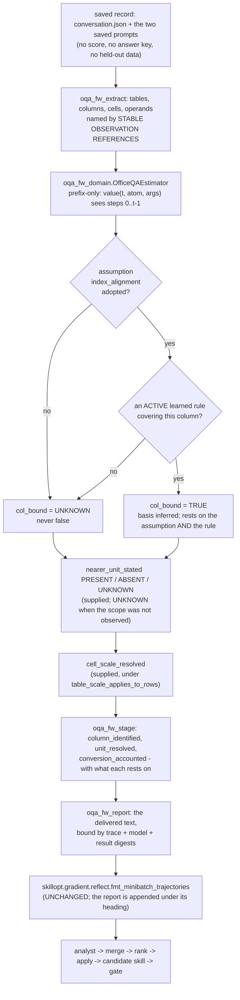

# OfficeQA: the ported learned action-and-stage framework (rule OQA-FW-1)

**Written 2026-11-22, 19:50-20:38 EST (48 minutes). Branch `officeqa-contracts`, commit `9d0e984`.
Resources used: 0 cluster jobs, 0 provider calls, 0 GPU, 0 CPU job-hours of the OfficeQA allowance.
All computation local; ~3 minutes of workstation CPU in total.**

Abbreviations on first use: **ALFWorld**, the household-task benchmark the contract machinery was
built on; **SkillOpt**, the skill-optimization system under study; **Lean**, the proof assistant used
as an independent checker; **CNF**, conjunctive normal form (an "and" of "or"s); **Kleene logic**,
three-valued logic in which a third value means *unknown* rather than false; **VX-1 / RP-1 / EB-1**,
the ALFWorld phases that produced the vocabulary extension, the counterexample repair and the
uncertainty correction; **LC / CC / LN**, OfficeQA's three earlier contract generations;
**obligation**, a condition a report says the record either establishes, refutes, or leaves open.

---

## 0. The four answers first

1. **Is the core now shared?** Yes, by copy and generalization, not by import. 32 ALFWorld source
   files are frozen in `research/officeqa/framework/upstream/` with a manifest of digests; the `fw_*`
   modules are those mechanisms with the ALFWorld vocabulary lifted out into a `Domain` object.
   Nothing imports the sibling worktree at run time, and a test asserts it.

2. **Does the learned layer do real work now?** Yes, and this is the difference from the audited LN
   generation. A four-cell comparison over all 48 permitted attempts: with the assumption adopted but
   **no learned rule**, 0 columns are bound and every interpretation obligation is UNKNOWN - exactly
   the state the previous generation was in. With the accepted rule, 1,152 columns are bound, 257
   `column_identified` and 252 `unit_resolved` obligations become DISCHARGED, and **522 obligation
   states change**. The rule is load-bearing, not an annotation.

3. **Did the learner learn, and could it be wrong?** It proposed, was refused, and was repaired. The
   most general form of the rule has 6 supporting and **2 refuting** columns in the permitted records,
   with the refuting columns named; the gate refused it. The narrowed form has 6 supporting, 0
   refuting, and a clean regression. Under the frozen model, a **reserved** attempt gives 12
   supporting and 0 refuting. The deletion-type repair - the one ALFWorld's RP-1 accepted and the one
   OfficeQA's CC/LN generation could not express - is exercised on a labelled constructed fixture.

4. **Does it help the optimizer?** **Not demonstrated, and the honest reading is unfavourable.** On
   the one real recorded optimization step examined, the control arm - no report at all - already
   produced "Read column headers literally before using any cell" and "record each operand with its
   period and unit". All four topics the framework's report carries are already in the control arm's
   own output. The report adds per-number citations, the states they support, and explicit unknowns;
   whether that changes the *edit* needs the analyst call, which is a provider call and was not made.

A fifth answer, unasked: **the checker's accusations were again its own.** The first version of this
slice reported 70 OUTSTANDING states on one attempt. None survived an audit. After the correction the
report accuses nobody - 0 OUTSTANDING in both arms - and what it contributes is provenance and unit
resolution, not blame.

---

## 1. The transferred snapshot

`research/officeqa/framework/upstream/MANIFEST.json`, digest `00a907064018a814`. Source worktree
`SkillOpt-learned-contract`, branch `contract/learned-contract`, commit `4a9914a9005a`.
**32 files, 412,244 bytes, 0 missing, and all 32 are untracked in the source**, so their hashes are
their only identity - the manifest records each file's sha256, byte count, source modification time
and git status.

| group | what it is | files |
|---|---|---|
| `v1_core` | the frozen v1 core VX-1 extends: representation, learner gate, estimator, reveal-order guard, Lean generation, stage contracts and tracker, fact ledger | 12 |
| `v1_vocab` | the vocabulary VX-1 imports as `V1`, and its record reader | 2 |
| `vx1` | VX-1: five kinds, typed existential variables, guards, Kleene evaluation, checker, gate, Lean, prompt builder | 9 |
| `rp1` | RP-1 counterexample repair: selection, driver, evaluation, audit, report | 5 |
| `eb1` | EB-1 uncertainty/forecast correction and report conditions | 4 |

**The ALFWorld worktree was not touched.** It was opened read-only (`open(..., 'rb')`), no module was
imported from it, so no byte-compilation cache was created there. Verified after the copy: commit
still `4a9914a`, 0 modified tracked files, and every `__pycache__` in the two source directories
predates today.

The snapshot is **importable in isolation**, which is why the parity tests below can compare the
ported core against the real implementation rather than against a description of it.

### Capabilities now active in OfficeQA

| capability | where | active in the first slice? |
|---|---|---|
| necessary / sufficient / effect kinds | `fw_ir.FIELDS` | declared, unused |
| completion relation (`completes`) | `fw_ir`, `fw_check.verdict_at` | declared, unused (OfficeQA has no completion atom) |
| **`concludes`** - `completes` generalized from "the task is complete" to a named consequence | `fw_ir`, `fw_check.conclusions_at` | **yes, this is the slice's kind** |
| typed entity bindings, existential and **subject** (universal) variables | `fw_ir.bindings`, `evaluate_pointwise` | yes |
| typed atom arguments | `fw_ir.validate_lit` | yes - it cut the search space from 3,358 candidates to 378 |
| guards | `fw_ir`, `fw_check` | declared, unused |
| explicit assumptions with adopt / drop, direct-contradiction testing, regression gating | `fw_learn.apply_proposal` | **yes** |
| unknown values with provenance (what each value rests on) | `fw_kleene` | yes |
| temporal scope: `all` / `introduced` / `once` | `fw_ir`, `fw_check.settle_step` | yes - `once` |
| persistence, invalidation and recovery | `fw_state._persist_value` | declared, unused |
| frozen model versions and prefix-only checking | `fw_ir.freeze`, `fw_state.Estimator.value` | yes |
| keep / add / revise / **retire**, four statuses including `refuted` | `fw_learn`, `fw_ir.STATUSES` | yes |
| repair including **deletion of a condition** | `fw_ir.drop_conjunct`, `fw_repair` | yes (fixture) |
| counterexamples and regression checks against earlier evidence | `fw_repair.regression` | yes |
| action-to-stage connections | `oqa_fw_stage` | yes |
| Lean checks of the model's application and the evidence counts | `oqa_fw_lean` | generated, **not compiled** |
| binding of the checked result to the delivered report | `oqa_fw_report.verify_binding` | yes |

A capability that is declared and unused here is not removed from the framework. ALFWorld's own
vocabulary declares no `concludes` and no subject variables; OfficeQA declares no `persists`. That
asymmetry is what a benchmark-specific adapter is for.

### Behavioural parity with the snapshot, asserted rather than assumed

`tests/test_officeqa_fw.py` imports the snapshot and the port side by side:

* `k_and` / `k_or` agree on **all** 1- to 3-argument inputs over {true, false, unknown};
* `merge` (which unites the assumptions, learned ids and steps a derived value rests on) agrees on
  every combination of five representative facts and all three values;
* `gate` agrees on every combination of support, counterexample and consistent counts for all five
  ALFWorld kinds.

Shared ancestry proves nothing; these three are the functions where a silent divergence would change
every downstream number, so they are compared against the real code.

---

## 2. The OfficeQA adapter, and two extraction corrections it needed

Entities are document structure, named by **stable observation references**: `tb:s12:1` is the second
table of the observation at conversation item 12, `co:s12:1:3` its fourth column, `ce:s12:1:4:3` a
data cell, `op:s13:2` the third number the actor wrote in message 13.

**Correction 1: a cell from an unnumbered read can now be cited.** The LN generation recorded the
assumption "an occurrence exists only where an observation line carries a line number and
pipe-delimited fields; a read without line numbers yields no position". Measured over the 48 frozen
attempts: **every `read` observation is unnumbered, and reads carry 571 of the 757 observed tables
(75.4%)**; the other 186 come from grep, which numbers its lines. Three quarters of the document
content could not be cited, and a cell that cannot be cited cannot witness anything. A reference here
needs no line number, and a citation reads
`step 6, table 1, row '1941', column 'Individual' [thousands]`.

**Correction 2: numbers are compared at the precision they were written to.** `oqa_ln_evidence._near`
is `abs(x - y) <= max(0.5, abs(y) * 1e-6)`. That absolute floor of 0.5 makes **1.8 equal to 2.0**, and
makes `x * 0.6 = x` an "identity". `oqa_fw_extract.near` compares at half a unit in the last written
place. `oqa_ln_evidence` is **not modified** - the frozen D-2..D-5 outputs stay reproducible - and
`near_legacy` is kept beside the correction so the difference can be measured rather than asserted.

**What correction 2 actually changes, measured over all 2,751 written operands of the 48 attempts**
(`--legacy-tolerance` runs the same code path with the old comparison, so the two sides cannot drift):
the loose comparison manufactures **50 matches the written precision does not support** - operands
with no cell match rise from 2,087 to 2,137. 44 of those 50 were ambiguous multi-cell matches anyway
(266 -> 222), and 6 were unique (398 -> 392). So the correction's main effect is to withdraw
ambiguity rather than to find new bindings, which is the right direction for a provenance checker but
is a smaller gain than "a tolerance bug is fixed" would suggest.

Both corrections are under a new version (`oqa.fw.extract.v1`), as instructed.

### Three defects of my own, each found by checking rather than assuming

1. **The unnamed-entity token was missing.** ALFWorld's `entities_of_type` appends one unnamed
   instance of the type, so an existential is never decided *false* merely because nothing has been
   named yet. I dropped it. The consequence was silent and total: with an empty pool `fw_ir.evaluate`
   has nothing to disjoin and returns **false**, so every rule's condition was false before its
   entities appeared. The general rule scored 0 supporting and 8 "consistent" cases; with the token
   restored it scores **6 supporting and 2 refuting**, which is the real picture. A test now asserts
   that an existential over an empty pool is UNKNOWN.

2. **The operand's written text was read under the wrong key.** `oqa_cc_extract.operands` calls it
   `raw`; I read `text`, got `None`, and the precision-aware comparison fell back to integer
   comparison - the very defect the correction exists for - while the report printed `None` where the
   number should be.

3. **The conversion obligation was raised for every number the actor typed.** 70 of one attempt's 227
   written numbers were reported OUTSTANDING. **Not one survived the audit.** 26 of them sat in a
   message that writes "divide by 1,000,000" six times; the rest were in messages that only *read the
   table aloud* ("I can see the Individual column, which contains ..."). Two fixes: the obligation now
   applies only to a number that is an operand or result of a written binary calculation, and a stated
   factor is looked for across the whole prefix rather than in the operand's own message. A differing
   factor is now UNKNOWN, not a violation, because which numbers a factor was applied to is not
   recorded.

This is the fourth time in this project that a checker's accusations have evaporated on audit. The
standing rule - read every accusing state against the agent's own words before reporting it as a
diagnosis channel - earned its place again.

### What is kept apart, by vocabulary category

Every atom carries exactly one category, and only two of them belong to the learner:

* **TASK** - what the question requires (the money scale it asks for).
* **GIVEN / OBS** - what a saved record literally shows (a table appeared; its header is split; its
  sub-label row has one cell per column; a flattened rendering of the same table was also observed).
* **MATH** - supplied arithmetic (the factor of ten between two scales).
* **MACHINERY** - supplied extraction and logic (which cell is in which column; the tri-state
  "is there a nearer unit annotation?"; Kleene evaluation).
* **LEARNED** - an empirical hypothesis the learner proposed and the gate accepted.
* **ASSUMPTION** - a named reading of document structure that is adopted, never established.

Reporting a MATH or MACHINERY fact as a discovery is the specific error this split exists to prevent,
and it is the error the LN generation made.

---

## 3. The execution path actually taken

**The takeaway from the diagram.** There are two gates on the licence, not one, and they fail
differently from how a reader might expect: the adopted assumption alone changes nothing (measured: 0
bound columns), because the licence also requires an active rule whose conditions hold at *this*
column. Everything downstream of the licence resolves to UNKNOWN when it is withdrawn - never to a
complaint about the agent. That is the property Lean is asked to check.

---

## 4. The bounded test: what was learned, and on what evidence

**Permitted records.** The 48 frozen attempts of the two-baseline training split (12 questions x 4
passes), freeze `LN_FREEZE.json`. Every trace digest matched the freeze (0 mismatches). The validation
split and the held-out set were not read.

**Split, and its overlap reported plainly.** Learning used the 23 learn-role attempts **minus one
reserved attempt**, `p3/UID0028`. Checking used that reserved attempt and the 24 check-role attempts.

* question overlap: **`UID0028` is in both** - the reserved record is a different *attempt* of a
  learned question, on the same documents, with a different trajectory;
* document overlap: 2 of 12 learn documents and 10 check documents;
* repeated attempts: all 12 questions appear 4 times in the corpus.

**This is the weakest part of the test and it is not disguised.** The rule needs a split rendering and
an independently observed flat rendering of the *same* table, and in these 48 attempts only `UID0028`
ever produced both. The corpus is all the training material there is - 12 questions x 4 passes - so
there was no third option that keeps validation sealed.

**The empirical model started empty.** Nothing was preloaded; the desired rule was not written by me.

**Batch 1, assumptions.** The learner proposed adopting two. Both accepted:

| assumption | decision | why |
|---|---|---|
| `index_alignment` - in a split header, the sub-label row's k-th cell is the sub-label of the k-th column | accepted, **directly testable** | no record contradicts it: no split table has a sub-label row of the wrong width |
| `table_scale_applies_to_rows` - a scale in a heading applies to the rows below it | accepted, **not directly testable** | recorded as challengeable only through contract counterexamples |

**Batch 2, the contract search.** 378 typed candidate hypotheses were scored; **3 were acceptable**.
The search offers the most general first, so a refusal comes before a narrowing.

*Refused, with its witnesses named* (6 supporting columns, **2 refuting**):

> after any step, for every `?s:column`: `col_label_agrees_flat(?s)` holds whenever for some
> `?t:table`: `col_of(?s,?t)` and `header_split(?t)`

Gate: `2 counterexample(s) in the evidence so far: p2/UID0028@17:co:s16:2:0,
p2/UID0028@17:co:s16:2:7`. Both are columns whose sub-label cell is the literal text `nan` - pandas'
empty cell printed out - where the merge falls back to the spanning parent and lands on the wrong
label. 234 of the corpus's 1,465 non-empty sub-label cells are that text.

*Accepted* (support 6, counterexamples 0, consistent 2, applicable 8):

> after any step, for every `?s:column`: `col_label_agrees_flat(?s)` holds whenever
> `col_child_label_present(?s)`

In words: **where a split table's sub-label row has a real label of its own at a column's index, the
index merge names that column correctly** - checked against independently observed flat renderings of
the same table. The condition the learner had to find is that the *sub-label's own cell* is filled,
as distinct from the merged label, which falls back to a spanning parent that is printed only at its
first column.

Model: `FW_MODEL.json`, version 2, digest `8fffff15bf961bcf`, vocabulary digest `1367b93cba6b15e1`.

**The separation is total.** Over the applicable columns there is no case of
sub-label-present-and-disagreeing, and no case of sub-label-absent-and-agreeing. Measured under three
pairing strengths:

| pairing requires | applicable | sub-label present & agrees | sub-label absent & disagrees | mixed |
|---|---|---|---|---|
| 1 shared data row (what `oqa_lc_cells.pair_tables` accepts) | 92 | 24 | 68 | **0** |
| **2 shared rows (used here)** | 32 | 24 | 8 | **0** |
| 3 shared rows | 32 | 24 | 8 | **0** |

**A pairing correction, and it changes the numbers a great deal.** `oqa_lc_cells.pair_tables` accepts
a pair on **one** shared data row and takes the first match. Measured here, that accepts pairings in
which the two renderings are different tables of equal width - in one case a trust-fund table judged
against a Gross/Refunds/Net-total table - and it turns 8 real disagreements into 68. The adapter
therefore requires two independent shared rows, and when several candidate flat renderings disagree
*with each other* at an index the column is left UNKNOWN rather than judged against an arbitrary one.
`oqa_lc_cells` is not modified; the guard is in the layer above.

**Prospective check under the frozen model.**

| set | applicable | support | counterexamples | consistent | undetermined |
|---|---|---|---|---|---|
| learning evidence (23 attempts) | 8 | 6 | 0 | 2 | 2,823 |
| **reserved attempt `p3/UID0028`** | **16** | **12** | **0** | 4 | 595 |
| the 24 check-role attempts | **0** | 0 | 0 | 0 | 2,063 |

The reserved attempt is a real prospective confirmation under a frozen model, and a weak one: same
question, same documents, different trajectory. **The 24 check-role attempts contain no applicable
case at all** - the rule is simply never exercised on those questions, and that is reported as no
applicable case rather than as confirmation.

**Explicit unknowns are the common case and are labelled as such.** 2,063 of the check set's column
entities are undetermined because no flat rendering of their table was ever observed. The report says
so, by count and by reason, and calls them gaps in the record or in the checker rather than findings
about the agent.

---

## 5. What changed when the learned model was removed

Four cells, all 48 attempts, same code path, the component **absent** rather than false.

| cell | bound columns | `column_identified` | `unit_resolved` | `conversion_accounted` |
|---|---|---|---|---|
| **A** nothing adopted, no rule | 0 | UNKNOWN 2,581 | UNKNOWN 2,457 / NOT_REQUIRED 124 | UNKNOWN 2,215 / NOT_REQUIRED 366 |
| **B** assumption adopted, **no rule** | **0** | UNKNOWN 2,581 | UNKNOWN 2,457 / NOT_REQUIRED 124 | UNKNOWN 2,215 / NOT_REQUIRED 366 |
| **C** assumption + the accepted rule | **1,152** | **DISCHARGED 257** / UNKNOWN 2,324 | **DISCHARGED 252** / UNKNOWN 2,205 / NOT_REQUIRED 124 | **DISCHARGED 13** / UNKNOWN 2,202 / NOT_REQUIRED 366 |
| **D** assumption + the **refused** general form | 4,887 | DISCHARGED 384 | DISCHARGED 260 | DISCHARGED 13 |

Three readings, and the first is the one that matters:

1. **B is identical to A.** The adopted assumption on its own changes nothing: not one column is
   bound, and every obligation stays UNKNOWN. So the 522 obligation-state changes from B to C are the
   **contract's** contribution, not the assumption's, and the contract is not a pass-through. This is
   the test the LN generation failed: there, removing the rule changed four annotation fields and
   nothing else.

2. **C -> D costs 135 obligation states.** The refused general form would bind 4,887 columns instead
   of 1,152 and claim 127 extra `column_identified` discharges - on exactly the columns where the flat
   renderings show the merge is wrong. The condition the gate forced the learner to find is a
   correctness condition, not a formality.

3. **Accusations: 0 with the model, 0 without it.** The slice establishes provenance and resolves
   units; it reports no failure of the agent at all. After the audit in section 2 this is the honest
   state of it, and it is a smaller claim than the first version of this report made.

Per attempt: 8 of 48 attempts have at least one state change; the largest is `p1/UID0014` with 210,
whose first changed row is

> `column_identified` DISCHARGED -> UNKNOWN, step 6, table 1, row `'1941'`, column `'Individual'`
> [thousands], resting on assumption `index_alignment` and learned rule
> `concludes.any.col_label_agrees_flat.1`

`p1/UID0014` is the campaign's actual 1,000x unit error, so the slice's resolutions land on the
attempt the whole unit question came from.

---

## 6. Repair, regression, and what is constructed

### The recorded path

On the real 48 attempts the over-general form is **refused on first contact** rather than accepted and
later refuted: its 6 supporting and 2 refuting columns are in the same attempt. So the narrowing
answers a refusal, and it passes with a clean regression:

| | support | counterexamples | consistent | undetermined |
|---|---|---|---|---|
| general form | 6 | **2** | 0 | 2,823 |
| narrowed | 6 | **0** | 2 | 2,823 |

Regression: 0 supporting cases lost, 2 counterexamples fixed, 0 gained, 0 newly undetermined -
`clean: true`. **The accept-then-refute-then-repair sequence does not occur naturally in this corpus**,
and that is stated rather than simulated.

### The constructed fixture - labelled, and not evidence about the corpus

Two synthetic records (`FIXTURE/F1_scaled`, `FIXTURE/F2_unscaled`) exercise the machinery the recorded
path could not reach. Both are tagged
`CONSTRUCTED FIXTURE - not evidence about the corpus` in the artifact.

1. **Accepted on F1** (3 supporting, 0 refuting), carrying a superfluous conjunct, stated as a
   biconditional:
   `col_label_agrees_flat(?s)` exactly when `col_of(?s,?t)` and **`scale_stated(?t)`** and
   `col_child_label_present(?s)`.
2. **Refuted on F1+F2** by the gate's own re-scoring: 3 counterexamples of kind
   `consequence_without_conditions` - F2's columns agree with their flat rendering while the rule's
   conditions do not hold, because F2 states no scale.
3. **Every repair the framework can express, each through the ordinary gate:**

| candidate | decision | support after | regression |
|---|---|---|---|
| **delete the `scale_stated` conjunct** | **accepted** | **6** | 0 lost, 3 fixed, 0 gained - clean |
| delete the `col_of` conjunct | accepted | 3 | clean, but keeps half the evidence |
| delete `col_child_label_present` | **rejected** | - | 4 counterexamples; gained 1 - not clean |
| narrow by adding `col_label_present` | **rejected** | - | fixes nothing |
| retire the rule | accepted | - | always available; a refuted rule is a finding |

4. **Selection policy, stated rather than left to enumeration order:** among the repairs the gate
   accepts with a clean regression, take the one that keeps the most evidence, then the simplest. The
   first-enumerated candidate keeps half the support, so taking it would have been arbitrary. The
   model goes v1 `superseded` -> v2 `active`, `operation: revise`.

**This is the repair the OfficeQA CC/LN generation could not express.** Its `repair()` returns
`new["conditions"] = list(c["conditions"]) + [extra_condition]` - append only - and a test asserts
both that the framework deletes and that the old module does not.

---

## 7. Lean

**Generated, not compiled.** `research/officeqa/lean/OqaFramework.lean`, 18,394 bytes, digest in
`research/officeqa/lean/MANIFEST.sha256`. There is no `lean` on this workstation, and compiling on the
cluster needs a deployed snapshot, which needs a push. **No Python mirror is substituted for the
compiler and nothing here is reported as a Lean result.**

What it is written to check, and the first item is what the previous generation did *not* do:

* **the learned model's application, not an exported verdict.** Every scored column is exported as its
  **literal values** - the Kleene value of each literal of each clause, and of the consequence - and
  Lean recomputes the CNF, the three-valued conjunction and disjunction, and the pointwise class from
  them. 24 such columns, one `example ... := by decide` each. An exported `refuted` boolean would have
  been checked against nothing.
* **the gate's counts**, re-derived by folding over the recomputed classes: support 18, consistent 6.
  A gate decision rests on those counts.
* **the stage algebra over the exported tuples of all four ablation cells**, so the headline numbers of
  section 5 are re-derived by the same definitions: 77 further examples.
* **7 general theorems**, among them `licenceWithdrawnNeverAccuses` (a withdrawn licence leaves every
  downstream obligation UNKNOWN, for *arbitrary* required and stated factors),
  `unknownNeverOutstanding`, `undeterminedWhenConditionUnknown`, `impliesNeverCounterOnFalseCondition`
  and `iffIsStrictlyStronger`.

101 examples and 7 theorems. Proof forms were copied from the file the cluster already compiled with 0
errors (job 66599377), not invented, since I cannot type-check here.

**An independent re-derivation in Python** re-computes every exported class and every weighted total
with a second, deliberately naive implementation: 24 of 24 rows agree, 0 of 12 total mismatches,
`clean: true`. This is **not** a substitute for the compiler; it catches the one failure the compiler
could not - an export that disagrees with what the checker recorded, in which case Lean would
faithfully verify the wrong numbers.

**What compiling it would not establish:** that the extraction found the right table, column or cell
(a trusted input); that the empirical rule is true of the Treasury corpus (measured, with its support
and scope, in section 4); that any reported state caused a task outcome.

---

## 8. Delivered optimizer inputs and candidate edits

### The integration is the one that already existed

One additive branch in `oqa_reports.build_one_lc` for condition `FW`, selected by the environment
variable the frozen campaign already uses. No new plumbing enters `skillopt`: the same arm variable,
the same cache key (which already includes the trace *and* the frozen model digest, so a second epoch
cannot be handed a first-epoch report), the same answer-key audit, which raises rather than warns. A
test asserts the `FW` branch returns **before** the three existing LC conditions' path, and that their
headings are unchanged.

### The matched comparison

One real recorded optimization step of the completed Original SkillOpt arm: step 1, epoch 1, 12
trajectories, starting skill `skill_v0000.md`, 2 patches, 3 merged edits, edit budget 4, fixed
learning-rate control, support counts [7, 7, 5].

Both analyst inputs were built by the **unchanged** native formatter
`skillopt.gradient.reflect.fmt_minibatch_trajectories` over the same 12 items and the same prediction
directory, differing only in whether the report variable was set:

* control 608,285 characters, treated 653,582 characters;
* **+621 lines added, 0 removed** -> the control input is a prefix-preserving subsequence of the
  treated one, so the arms differ in the report and in nothing else. The harness asserts this rather
  than claiming it.

### Which native stages ran

| stage | ran | what happened |
|---|---|---|
| analyst | **no** | a provider call; SkillOpt runs on the cluster in this project. Both request bodies are built and digested at zero cost; the control arm's recorded patches are used as its output. |
| merge | **no** | `skillopt.gradient.aggregate.merge_patches` calls the optimizer. The control arm's recorded merge is read. |
| rank | **no, and it legitimately did not fire** | 3 merged edits against an edit budget of 4, so `rank_and_select` was never reached in the recorded step either. Recorded as not-fired; no patch was fabricated to force it. |
| **apply** | **yes, for real** | `skillopt.optimizer.skill.apply_patch_with_report` is pure Python. Re-executed here on the recorded merged patch, it **reproduces the recorded candidate skill byte for byte** and its three per-edit statuses match the recorded ones. |

To import the two native stages on a workstation without the `openai` package, a stub is installed
that **raises on every attribute**, so a stage that tried to reach a provider would fail loudly rather
than proceed quietly. Whether the stub was installed is recorded in the artifact.

### The trace, end to end, for the control arm

> **observation** `step 6` of `p1/UID0014`: a read returns a split-header table, `(in thousands of
> dollars)`, sub-label row aligned
> -> **learned contract** `concludes.any.col_label_agrees_flat.1` covers column `co:s6:...` because
> its sub-label cell reads `Individual`
> -> **checked consequence** `col_bound = TRUE` (basis `inferred`; rests on `index_alignment` and that
> rule) -> `nearer_unit_stated = ABSENT` -> `cell_scale_resolved = TRUE` -> `column_identified` and
> `unit_resolved` **DISCHARGED**, citation `step 6, table 1, row '1941', column 'Individual'
> [thousands]`
> -> **delivered report** `UID0014.<key>.md`, bound by `trace d7c13ba5428e913f`, model
> `8fffff15bf961bcf`, checked result `44217c8079e58b5b`
> -> **proposed edit** (control arm, no report): `insert_after` - "Read column headers literally
> before using any cell: 'net' often means gross minus refunds ..."
> -> **final candidate instruction**: that line, in `candidate_skill.md`, which the gate then
> **rejected** (candidate 0.333 against a 0.417 rollout).

12 reports were generated and delivered through the native integration.

### The uncomfortable part, measured

All four topics the framework's report carries are **already present in the control arm's own output**,
produced from the raw traces with no report at all:

| topic | already in the control arm? | the control's own phrases |
|---|---|---|
| column header identity | **yes** | "column header", "headers literally", "header block" |
| money scale / unit | **yes** | "unit", "divide by" |
| citing a position | **yes** | "record each operand", "operand with its" |
| period / row identity | **yes** | "fiscal year", "annual", "monthly" |

The control analyst's failure summary names "Table/column semantics misread: 'net' = gross-refunds
(not receipts-outlays)" with a count of 4. So on this step the framework's report is **not** what
reveals the failure mode. What it adds is per-number citations, the states those citations support,
and explicit unknowns. Whether that changes the *edit* is exactly what the unrun analyst call would
decide.

### Does the candidate's wording survive? (control arm, counted not judged)

The starting skill contains **no** obligation words. The candidate adds `critical` 1, `do not` 3,
`never` 1, while optional vocabulary rises from `if` 3 to `if` 11. Two of the three edits mix
obligation and optional vocabulary in one block. Recovery language **is** preserved - "If the needed
figure is absent, answer from the best available evidence and commit", "Give the best qualitative
answer instead of searching indefinitely". So the one candidate examined hardens the skill without
closing off recovery, and the gate rejected it anyway.

---

## 9. Verification: what ran, and what did not

**22 new tests, all passing** (`tests/test_officeqa_fw.py`), run with the scratchpad pytest. They
assert the snapshot's digests, that nothing imports the sibling worktree, three-way behavioural parity
with the snapshot, that deletion-repair exists here and not in the old generation, the unnamed-token
property, both extraction corrections, that a withdrawn licence never accuses, that a narrated number
carries no conversion obligation, the Lean file's theorem names and manifest digest, report hygiene,
and that the three LC conditions were left alone.

**54 of 55 related tests pass locally.** The one failure,
`test_officeqa_three_arm.py::test_the_budget_and_the_running_code_agree_on_the_prompt_limit`, fails on
`ModuleNotFoundError: No module named 'openai'` inside `skillopt/model/azure_openai.py` - a
pre-existing limitation of this workstation, unrelated to any change here. **The full suite
(2,615 tests at the last cluster run) has not been run against these changes**, because that needs a
deployed snapshot.

**Not run:** Lean compilation; the analyst and merge stages; any actor episode; any validation or
final evaluation; the campaign.

---

## 10. Resources and what is sealed

| | |
|---|---|
| cluster jobs submitted | **0** |
| provider calls | **0** |
| GPU | **0** |
| OfficeQA CPU job-hours consumed | **0.00** of the 3.08 remaining |
| teacher attempts consumed | **0** of 18 |
| local workstation CPU | about 3 minutes in total (the 378-candidate search runs in 6 s) |

Verified on the cluster at 20:36 EST: the only OfficeQA jobs today are the three D-2 submissions that
predate this work (66598457 and 66599047 cancelled while PENDING at zero cost; 66599377 COMPLETED in
00:04:03 on one core). Today's other jobs - `ac2-pfl`, `ac2-pfx`, `ac2-pre`, `ac2-leanprobe`,
`lc-rank` - belong to the ALFWorld session's AC-2 campaign and are not mine to touch. The budget
ledger reads `verdict: PASS`.

**Sealed and untouched:** the 30 final questions and their scores, the 12 validation scores, the
held-out trajectories. The baselines were **not** rerun, and did not need to be: no actor, tool,
document-rendering or scorer change was made, and the three existing report conditions dispatch
exactly as before.

---

## 11. The campaign, prepared and verified but not submitted

`FW_CAMPAIGN_SPEC.json`, digest `a15a5248c1ba5ab0`. Every protocol item was checked against the
executed baseline's own `config.json` rather than against the instruction's description of it, and
**all seven match**: 4 epochs, 6 slow-update samples, slow update on, gate on, edit budget 4, fixed
learning-rate control, split directory with seed 42. The campaign bank starts **empty** again; the
demonstration's model is evidence about the machinery, not a prior.

Estimate, from the completed Original SkillOpt arm on the same splits and settings: 16 optimizer calls
and about 873,000 optimizer prompt tokens (the measured +7.4% report overhead included; the report
itself costs no model call), 673 actor calls, 60 final-evaluation attempts, no GPU, and about 1.5 CPU
job-hours for the controller. The Lean job is 1 CPU, 4 GB, 20 minutes, about 0.34 CPU job-hours.

**What blocks submission is one authorization, not any remaining implementation work.**
`research/deploy.sh` refuses a commit that is not on `origin`, and pushing is recorded as withheld. So
the Lean compile and the campaign both wait on the same decision.

---

## 12. Limitations, stated plainly

1. **The learning evidence is narrow.** All 32 applicable columns come from one question, `UID0028`,
   and the prospective check is a reserved *attempt* of that same question on the same documents. The
   rule's separation is perfect (24/24 and 8/8, with no mixed case at any pairing strength), but it is
   perfect on a small set.
2. **The 24 check-role attempts contain no applicable case.** The rule is not exercised on them at
   all.
3. **No added value over the control is demonstrated.** The no-report arm already produced the
   column-header instruction. The comparison that would settle it needs the analyst call.
4. **Lean has not been compiled.** The file is generated, digested and self-checked against a second
   Python implementation; nothing is claimed about the compiler.
5. **The full test suite has not run against these changes.**
6. **`conversion_accounted` resolves to DISCHARGED only 13 times** across all 48 attempts. The slice
   touches the unit question's provenance much more than its arithmetic, because a stated factor's
   application to a particular number is not recorded.
7. **A differing stated factor is reported UNKNOWN**, deliberately. Calling it a violation would
   repeat the error the D-2 audit found 13 times.
8. **The report is long** - about 14,000 characters for an attempt with 227 written numbers. It grew
   the analyst's input by 7.4% on the measured step. Whether that is a good trade is unmeasured.

---

## 13. Provenance

| artifact | digest |
|---|---|
| `runs/20261122-officeqa-framework/FW_LEARN.json` | `458d299da3c9e3e3` |
| `FW_CHECK.json` | `682bf27f6d611c82` |
| `FW_ABLATE.json` | `39cbb119bc5d904d` |
| `FW_GRID.json` | `ecccb0de68c9bf69` |
| `FW_REPAIR.json` | `9f6d003464be6e07` |
| `FW_LEAN.json` | `3d8817553c6f3ff8` |
| `FW_EDIT.json` | `48e485dc368a8f55` |
| `FW_CAMPAIGN_SPEC.json` | `a15a5248c1ba5ab0` |
| `FW_MODEL.json` (frozen, read-only) | `8fffff15bf961bcf` |
| `OqaFramework.lean` | `a26e48a1a31a154825cd77968846d24444a29369a3bcc57d55bb348dd5a78786` |
| `framework/upstream/MANIFEST.json` | `00a907064018a814` |

Source: branch `officeqa-contracts`, commit `9d0e984`, tree clean, **not pushed**. ALFWorld reference:
`contract/learned-contract` at `4a9914a9005a`, unmodified. Records: the frozen training split
`LN_FREEZE.json` and the completed Original SkillOpt arm at
`runs/20261121-officeqa-two-baselines/`. Every digest above excludes the clock, so re-deriving an
artifact reproduces its digest.

**Labels used throughout:** *recorded evidence* is a measurement over the 48 saved attempts;
*constructed test* is the labelled fixture of section 6 and the in-process fixtures of the test file;
*interpretation* is any sentence that explains why a number is what it is. The four answers in section
0 are measurements except answer 4, whose second half is interpretation of a single step.
