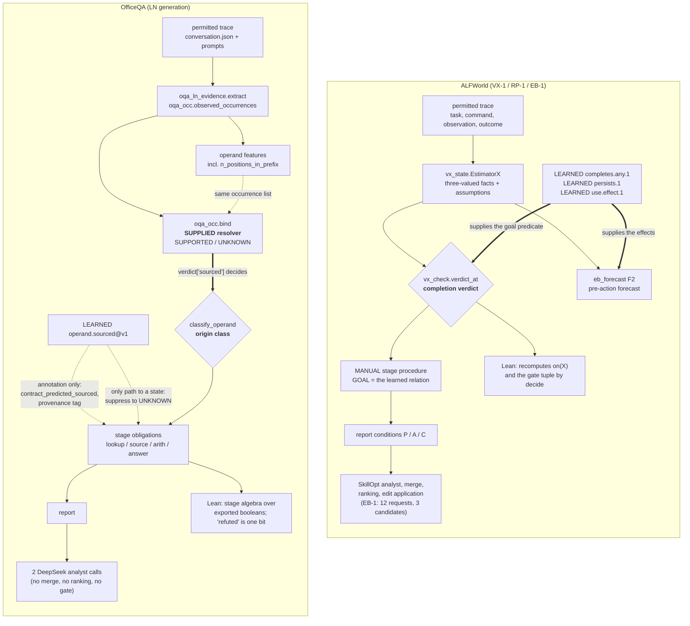

# Implementation-parity audit: OfficeQA against the accepted learned action-and-stage contract design

**Offline. Zero provider calls, zero learner calls, zero optimizer calls, zero actor episodes, zero GPUs, zero
cluster jobs.** Written 2026-11-22, 02:00-03:30 EST (times from `date`). Nothing in the ALFWorld worktree was
written, executed or modified; every ALFWorld statement below comes from reading its files and its saved reports.

- **This worktree:** `/Users/yaojiaming/dev/lean_skillopt/SkillOpt-officeqa`, branch `officeqa-contracts`,
  HEAD `39a7e33` at the start of this audit, working tree clean, everything tracked.
- **Read-only reference:** `/Users/yaojiaming/dev/lean_skillopt/SkillOpt-learned-contract`, branch
  `contract/learned-contract`, HEAD `4a9914a`. **Every learned-contract file there is untracked** (`git status`
  reports 70 `??` entries), so no commit contains them and digests are the only identity they have. They are
  recorded in section 2.
- **Third worktree,** `/Users/yaojiaming/dev/lean_skillopt/SkillOpt` at `4a9914a`: not touched, not read.

**Labels used throughout.** **[FACT]** a recorded datum or a digest. **[MEASURED]** a deterministic computation
run during this audit on frozen inputs. **[INTERPRETATION]** my judgement. **[PROPOSAL]** not done and not
authorized.

---

## 1. The four answers

### 1.1 Do the branches share the same core implementation? **No. They share no code at all.** [MEASURED]

No OfficeQA module imports anything from the ALFWorld tree, and no name from `research/learned_contracts`,
`research/vocab_ext`, `research/trace_only` or `research/order_audit` appears anywhere in `research/officeqa/`
(grep over 105 tracked files returns nothing). The relationship is a **one-time copy in 2026-11-16**, recorded
per-file in `OFFICEQA_TRANSFER_MANIFEST.json` with each source's sha256, and then two further OfficeQA
generations written locally on top of it.

That is not, by itself, a defect. The question is whether the **behaviour** is equivalent, and for the
2026-11-16 generation it largely is. I verified the reference has not moved by comparing all eight reference
copies in `research/officeqa/transferred/` against the live ALFWorld files, byte for byte [MEASURED]:

| module | `transferred/` | live ALFWorld | |
|---|---|---|---|
| `ir.py` | `7bf531504c8103db` | `7bf531504c8103db` | same |
| `learn.py` | `dce247e991b35fa5` | `dce247e991b35fa5` | same |
| `replay.py` | `b0cf8398130dbb1c` | `b0cf8398130dbb1c` | same |
| `state.py` | `250fc1b73785fa16` | `250fc1b73785fa16` | same |
| `fact_ledger.py` | `c805634fc0e019ba` | `c805634fc0e019ba` | same |
| `stage_contracts.py` | `c220efd38ad00f1d` | `c220efd38ad00f1d` | same |
| `stage_tracker.py` | `bec91eda08dcf9c0` | `bec91eda08dcf9c0` | same |
| `lean_gen.py` | `f8a312c83424bbc3` | `f8a312c83424bbc3` | same |
| `vocab.py` | `e857150a39a166bd` | `e857150a39a166bd` | same |

So the port's own reuse table can be trusted and the comparison below is against the current reference. Those
fifteen copies are **reference material only**: nothing in `research/officeqa/` imports from `transferred/`
(grep over all 105 tracked files returns no import).

### 1.2 Are their active learning / checking / repair behaviours equivalent? **No.** [MEASURED]

OfficeQA has **three generations**, and the one the milestone uses is not the faithful port:

| generation | modules | what it can represent | where it ran |
|---|---|---|---|
| **LC** (2026-11-16 port) | `oqa_lc_*` | `requires` / `suffices` / `effect`; assumptions; add / revise / **retire** / keep; assumption **adopt / drop**; auto-refutation | the live three-arm campaign (`oqa_lc_arm.seed` / `.evolve`) |
| **CC** (amendment B-1, 2026-11-17) | `oqa_cc_*` | one kind, `conclusion IF conditions`, entity-bound, four-valued, stage link; repair = **append one condition** | one offline check, never in a campaign |
| **LN** (amendment D-1, 2026-11-21) | `oqa_ln_*` on `oqa_cc_ir` | the same single kind, one learnable conclusion `operand_sourced` | the milestone and the paired rehearsal |

ALFWorld's current line (VX-1 / RP-1 / EB-1) **extends** its v1 core rather than replacing it — `vx_learn.py`
literally does `import learn as L1` — and carries five contract kinds (`requires`, `suffices`, `effect`,
`completes`, `persists`), typed existential variables, guards, and the full keep/add/revise/retire plus
assumption adopt/drop repair vocabulary.

So the LC generation is close to parity and is the one actually wired into a campaign; the CC/LN generation,
which is what "the learned-contract milestone" means, is **narrower than the port it descends from** on
representation and on repair.

### 1.3 Where does OfficeQA's current configuration diverge from the accepted design? **In the learning target, first and worst; then in repair, in what Lean checks, and in what "prediction" means.** [MEASURED]

The decisive finding is about the target, not about portability.

The LN rule is `operand_positions(operand, 1) AND operand_source_tool(operand, grep) -> operand_sourced`.
`operand_sourced` is the supplied resolver's `SUPPORTED` label. `oqa_occ.bind` sets `SUPPORTED` when a value has
exactly one observed position **and** at least one supporting corroboration; `oqa_occ.corroborations` sets the
corroboration `QUERY` when the occurrence's grep pattern tokens meet its line tokens. **A grep returns a line
because its pattern is on that line.** So the antecedent entails the consequent through supplied code.

Measured over all 48 frozen attempts, corrected (D-2) extraction [MEASURED]:

| unique-position bindings | n | `QUERY` fired | `SUPPORTED` |
|---|---|---|---|
| the position came from a **grep** hit | 39 | **39 (100%)** | **39 (100%)** |
| the position came from a **read** | 19 | 0 | 6 (32%) |

P(`SUPPORTED` | `QUERY` fired) = **39/39 = 1.000**. The rule is a theorem of `oqa_occ.corroborations`, found by a
paid model in a contingency table. Artifact: `runs/20261122-officeqa-parity/PA2_TARGET.json`,
sha256 `c471e078923342ab…`.

### 1.4 What is the smallest correction needed before another meaningful experiment? **Change the target, not the codebase.** [INTERPRETATION]

The generic machinery is already shared in substance, and three of the four code gaps below only matter *after*
the target changes. The one code change that is necessary **independently** of the target is the repair
interface: `oqa_cc_ir.repair` can only append a condition, so ALFWorld's actual repair — deleting a conjunct —
is not expressible in OfficeQA at all. Section 7 gives the plan; section 8 gives two candidate targets.

---

## 2. Terms, and the exact versions compared

**Terms, on first use.** A **contract** is a structured, checkable claim about an action or a document, with a
version and recorded evidence. **LC / CC / LN** are the three OfficeQA generations in the table above. **VX-1**
is ALFWorld's vocabulary-extension study, **RP-1** its counterexample-repair pilot, **EB-1** its editing
comparison, **CR-1** its consolidation study. An **obligation** is a task requirement a checker tries to
discharge; its states here are DISCHARGED, VIOLATED, OUTSTANDING, UNKNOWN. **Provenance labels** mark where a
clause came from: TASK (the question sentence), GIVEN (supplied structure), MATH (a definition), OBS (an
observation or the actor's own message), LEARNED (an empirical hypothesis). The **resolver** is
`oqa_occ.bind`, supplied deterministic code that tries to bind a number the actor wrote to an observed cell.
An **ablation** runs the pipeline with a component ABSENT, holding everything else fixed.

### 2.1 The accepted design and its amendments [FACT]

v0.1 plus amendments A1-A5 is the current agreed design; there is no document labelled v0.2. Digests at the time
of this audit, so a later session can tell whether the reference moved:

| document | sha256 (first 16) | bytes |
|---|---|---|
| `docs/LEARNED_CONTRACT_DESIGN.md` (v0.1) | `b115079e6ea7cc82` | 15,542 |
| `..._AMENDMENT_A1.md` (information access) | `f2a583610aafd8e4` | 5,925 |
| `..._AMENDMENT_A2.md` (stage-plus-action architecture) | `be7c1f80ebcaa8a5` | 10,968 |
| `..._AMENDMENT_A3.md` (corrected diagnostics) | `cc96cf76513e0f37` | 11,130 |
| `..._AMENDMENT_A4.md` (fact ledger, propagation) | `bbbb1de5827bdc75` | 24,093 |
| `docs/research/VX1_AMENDMENT_A5.md` (vocabulary extension) | `b1f4ba2bcf108540` | 23,926 |

The first five match the digests the 2026-11-16 port note recorded, so **the accepted design has not changed
since the port**. A5 is newer than the port and is the one OfficeQA has never seen.

### 2.2 ALFWorld implementation files, as read [FACT]

All untracked at HEAD `4a9914a`. Digests and last-modified times taken during this audit. The VX-1 and RP-1
files were last modified 2026-11-21 between 00:59 and 01:11 EST and did not change while I read them; the
`research/eb1/` and `research/cr1/` files are being worked on by the ALFWorld session and are recorded here only
as the version I read.

| file | sha256 (first 16) | bytes |
|---|---|---|
| `research/learned_contracts/ir.py` | `7bf531504c8103db` | 9,119 |
| `research/learned_contracts/learn.py` | `dce247e991b35fa5` | 15,333 |
| `research/learned_contracts/replay.py` | `b0cf8398130dbb1c` | 14,393 |
| `research/learned_contracts/state.py` | `250fc1b73785fa16` | 8,628 |
| `research/learned_contracts/fact_ledger.py` | `c805634fc0e019ba` | 12,613 |
| `research/learned_contracts/stage_contracts.py` | `c220efd38ad00f1d` | 18,305 |
| `research/learned_contracts/lean_gen.py` | `f8a312c83424bbc3` | 9,881 |
| `research/vocab_ext/vx_vocab.py` | `a63ce811f2ff7b9c` | 9,656 |
| `research/vocab_ext/vx_ir.py` | `d96ca618bdaf7128` | 15,184 |
| `research/vocab_ext/vx_learn.py` | `3b761c05d8d537ed` | 11,899 |
| `research/vocab_ext/vx_check.py` | `d2c831210ef60276` | 14,015 |
| `research/vocab_ext/vx_lean.py` | `971e1f202e7c0c30` | 17,685 |
| `research/vocab_ext/rp_run.py` | `d92e1b7e06cf38a4` | 17,653 |
| `research/vocab_ext/rp_eval.py` | `89c44e24b6585a9e` | 17,155 |
| `research/eb1/eb_forecast.py` | `b0c449d0049ba906` | 12,402 |

### 2.3 OfficeQA implementation files [FACT]

All tracked and committed on `officeqa-contracts`; the last commit that touched each is given, so a later
session can see which generation a file belongs to.

| file | sha256 (first 16) | bytes | last commit |
|---|---|---|---|
| `oqa_lc_ir.py` | `44ff3e9e24585ec3` | 12,362 | `60983a9` |
| `oqa_lc_learn.py` | `d6cced16da3ccd88` | 21,651 | `fc26cdc` |
| `oqa_lc_replay.py` | `dd86a4fb49e40b7e` | 16,304 | `60983a9` |
| `oqa_lc_chain.py` | `8262c94557f01a6c` | 39,703 | `82a48d0` |
| `oqa_lc_arm.py` | `f430a6219b85fc35` | 21,287 | `60983a9` |
| `oqa_cc_ir.py` | `cdcb0604e18c471f` | 12,408 | `95e5437` |
| `oqa_cc_learn.py` | `1786c6bef73d0d3c` | 18,086 | `f44afc1` |
| `oqa_cc_check.py` | `4d30165d15cd417b` | 25,096 | `f80ec8d` |
| `oqa_ln_vocab.py` | `a68dfc305de2c480` | 6,200 | `95e5437` |
| `oqa_ln_learn.py` | `ceafabe277a0e4fe` | 18,340 | `652931f` |
| `oqa_ln_check.py` | `ba7bfeade961a042` | 36,057 | `652931f` |
| `oqa_ln_evidence.py` | `0ee9fd12c06b4f4f` | 32,714 | `652931f` |
| `oqa_ln_lean.py` | `61d4880a89b11eeb` | 23,210 | `90ef7cf` |
| `oqa_occ.py` | `258e96844e32a0b9` | 21,386 | `652931f` |
| `oqa_obligations.py` | `f71992d733a2981d` | 7,701 | `10a413a` |

### 2.4 Saved models and records used [FACT]

| artifact | identity |
|---|---|
| frozen record set | `runs/20261121-officeqa-learner/v1_freeze/LN_FREEZE.json`, 48 attempts, 12 questions, six learning / six checking |
| LN model r1 | `v2_learn/r1_model_v1.json`, contract `operand.sourced@v1` |
| LN model r2 | `v2_learn/r2_model_v1.json` |
| CC model | `CC_MODEL_v1.json` sha256 `96c3d1bd9aad6f4d…` (cluster path; its check output is local) |
| LC campaign models | `runs/20261118-officeqa-status/pull/contracts/{model_M0,arm_B/*,arm_C/*}.json` |
| D-2 ablation | `runs/20261121-officeqa-learner/v5_d2/D2_RULE_r1.json`, 25 attempts, 2x2 |
| this audit's probes | `runs/20261122-officeqa-parity/PA1_CALLPATH.json` `55a71d3140fe9d99…`, `PA2_TARGET.json` `c471e078923342ab…` |

---

## 3. The parity matrix

Classification vocabulary, used once per row: **SHARED** (literally the same code), **EQUIVALENT SEPARATE**
(different code, same behaviour), **ADAPTER** (a difference the benchmark requires), **RESTRICTION** (the library
can do it, the active configuration forbids it), **BYPASSED/MISSING** (the component exists but no conclusion
depends on it, or it is absent), **UNVERIFIED**.

Throughout, "OfficeQA" means the **LN generation** unless a row says otherwise, because that is what the
milestone, the Lean file and the paired rehearsal actually ran.

### 3.1 Permitted information and extraction

| | |
|---|---|
| **Intended role** | Turn a permitted trace into typed entities, observations, identity and time, with unknowns kept explicit (design §4.A). |
| **ALFWorld** | `vx_vocab.parse_obs` / `vx_vocab.parse_command` -> `vx_state.EstimatorX`. Entry point `vx_check.verdict_at` / `predict_episode`. The learner's view is the analyst view only: task, task type, command, observation, outcome. Typed entities (objects, receptacles), event atoms `activated/picked/released`, the state atom `on(X)`, the derived `co_located(X)`, three-valued facts each carrying the assumptions and rule ids it depends on. |
| **OfficeQA** | `oqa_ln_evidence.extract` + `oqa_occ.observed_occurrences`. Entry point `oqa_ln_check.stage_report`. Permitted input is `conversation.json` plus the saved prompts; `ground_truth`, `soft`, `hard` and provider `reasoning_content` are excluded. Entities are tables, headers, cells, values, calculations. Occurrences are `(document, line, field)` with the rendered `field_text` kept as context (D-2). |
| **Shared?** | **EQUIVALENT SEPARATE** for the discipline; **ADAPTER** for the content. The information boundary, the unknown-by-default rule and the "latest record is not physical state" distinction are preserved in both. |
| **Restriction / gap** | **MISSING, and it is the binding constraint on OfficeQA's one task-relevant contract.** `oqa_cc_check` cannot resolve a data cell's **column header** in a read window: of 113 operands checked under the CC model, 50 produced a binding attempt and **all 50 had `header_known: false`** (`column_basis: "UNKNOWN"`, `column_leaf_basis: "LEAF_ONLY"`). The other 63 had no cell match at all. |
| **Witness** | `runs/20261121-officeqa-contract/v6_lean/CC_CHECK_descriptive.json`; the clause row reads `"why": "not observed for this cell: column header; absence cannot be asserted"`. [MEASURED] |

### 3.2 Contract representation

| | |
|---|---|
| **Intended role** | Necessary conditions, sufficient conditions, effects, persistence and completion relations, with directions explicit (design §4.B; A5 §3.3). |
| **ALFWorld** | `vx_ir.py`: five kinds — `requires`, `suffices`, `effect` (with a guard), `completes` (scope = a verb or "any"), `persists` — plus typed existential variables `?o`, `?l` declared in an `exists` map, Kleene three-valued evaluation, and per-value dependency on assumptions and rule ids. |
| **OfficeQA, LC** | `oqa_lc_ir.py`: `requires` / `suffices` / `effect`, 0-ary atoms, model assumptions, Kleene logic. A faithful port of `ir.py`. |
| **OfficeQA, LN** | `oqa_cc_ir.contract` has exactly **one** kind, `"binding"`: a `conclusion` plus a conjunction of `conditions`, with entity arguments and a provenance label per clause. No `effect`, no `completes`, no `persists`, no `exists`, no guard. |
| **Shared?** | **ADAPTER** for dropping `requires`/`suffices`: OfficeQA's document tools almost never report failure, so condition-based success prediction is UNKNOWN at PRE by construction, and the port note records this with a test. **RESTRICTION** for dropping `effect`: the LC generation had effect contracts and the LN generation has no way to state what a tool call returns. |
| **Witness** | `oqa_cc_ir.py` lines 113-126 (the constructor hard-codes `"kind": "binding"`); `vx_ir.py` module docstring lists the five kinds. |

### 3.3 Learning

| | |
|---|---|
| **Intended role** | An LLM proposes a hypothesis in a fixed vocabulary; deterministic code validates, scores and gates it. The target must be an environmental or task-relevant relationship, not a label another supplied module already computes. |
| **ALFWorld** | `vx_llm` proposes; `vx_learn.apply_proposal` gates. Targets: *is the task complete after this step* (label from the analyst-visible outcome plus the declared harness rule) and *does a lamp stay on* — both facts about the environment that no supplied module computes from the prefix. |
| **OfficeQA** | `oqa_ln_learn` shows DeepSeek a deterministic contingency table over the learning records and asks for one condition in `oqa_ln_vocab.LEARNER_CONDITIONS`; `oqa_ln_vocab.validate` rejects a proposal that names a predicate outside the vocabulary or relabels a provenance. The machinery is sound. |
| **Shared?** | **EQUIVALENT SEPARATE** for the machinery. **The target is the divergence.** |
| **Restriction / gap** | `operand_sourced` **is** the resolver's `SUPPORTED` label, and one of the rule's two conditions, `operand_positions(operand, 1)`, is the first conjunct of the resolver's own definition. The second, `operand_source_tool(grep)`, entails the `QUERY` corroboration that is sufficient for the label. 39/39 grep-sourced bindings confirm it. Agreement is the ceiling; the rule cannot add a conclusion. |
| **Witness** | `oqa_occ.bind` lines 295-299 (`SUPPORTED if supporting else UNKNOWN`), `oqa_occ.corroborations` lines 254-263 (`QUERY` when pattern tokens meet line tokens), `oqa_occ.SUPPORTING = ("ROW_LABEL", "QUERY")`; `PA2_TARGET.json`. [MEASURED] |

### 3.4 Model state

| | |
|---|---|
| **Intended role** | Versions, parent links, evidence, assumptions, accepted and rejected hypotheses, nothing deleted (design §4.E). |
| **ALFWorld** | `vx_ir` / `vx_learn`: statuses active / refuted / retired / superseded / rejected, with counterexamples kept; model assumptions `distinct_locations`, `init_empty_hands`, `init_off`, `persistence`; semantic digest; parent chain. |
| **OfficeQA, LC** | `oqa_lc_ir` + `oqa_lc_learn`: the same five statuses, the same assumption set discipline, `normalize`/`semantic_sha`, freeze-by-digest. **Full parity.** |
| **OfficeQA, LN** | `oqa_cc_ir` has **two** statuses, `active` and `superseded`; no assumption set at all; `model_sha`, `freeze` (chmod 0444) and `load_frozen` verify the digest, and `parent_sha256` chains model versions. |
| **Shared?** | **EQUIVALENT SEPARATE** at LC. **RESTRICTION** at LN: refuted / retired / rejected have no representation, and a model with no assumptions cannot record an assumption drop — which is exactly the repair ALFWorld performed. |
| **Witness** | `grep -n '"retire"\|"revise"\|"drop"\|assumption' oqa_cc_ir.py oqa_ln_vocab.py oqa_ln_learn.py` returns **nothing**; the same grep on `oqa_lc_learn.py` returns the full operation set at lines 9, 123, 128, 162-206. [MEASURED] |

### 3.5 Checking and prediction

| | |
|---|---|
| **Intended role** | Freeze the model, build features from the prefix only, commit the prediction, then reveal the next observation (design §4.D). |
| **ALFWorld** | `vx_check.predict_episode`: at step *t* it builds a **synthetic post-state** from the learned effect contracts of command *t* and evaluates the completion relation on it, committing through `replay.Revealer`'s hash chain **before observation *t* is revealed**. The forecast is explicitly conditional ("if the command has its learned effects, is the task complete?") and never predicts whether the command succeeds. RP-1 §9.2 verified it empirically: withholding every observation from the forecast step changed **0** of 2 x 1,369 checking forecasts. |
| **OfficeQA** | `oqa_ln_check.predict` writes one prediction per operand from the contract and the features alone, digests it over content (not the clock), and only then `resolve` reads the resolver's verdicts. The order is enforced by two files and two digests. |
| **Shared?** | **EQUIVALENT SEPARATE** for commit-before-reveal. **DIVERGENT in what is revealed.** |
| **Restriction / gap** | ALFWorld reveals *the environment's next observation*. OfficeQA reveals *a deterministic label computed by supplied code from the same prefix the features came from*. `n_positions_in_prefix` and the resolver's `match` are both derived from the same `observed_occurrences` call. A commit-before-reveal protocol over a label that is a function of the committed inputs is a real protocol about a target that cannot surprise it. |
| **Handling of missing effects** | ALFWorld had a genuine defect here and fixed it: F1 treated "no learned effect" as "nothing changes", producing confident NOTs; `eb_forecast` (F2) makes those facts UNKNOWN under a declared `REPORT_SCOPE` frame assumption, removing every unsupported confident NOT and introducing 0 false completion claims. **OfficeQA has no counterpart because the LN generation has no effect contracts at all** — there is no forecast whose missing effect could be mishandled. |
| **Witness** | `oqa_ln_evidence.py` lines 255-266 (the feature block) and `oqa_occ.bind`; `vx_check.py` docstring; `eb_forecast.py` docstring. |

### 3.6 Repair

| | |
|---|---|
| **Intended role** | Keep / add / revise / retire, widen or narrow, driven by explicit counterexamples, with earlier records re-scored (design §4.E). |
| **ALFWorld** | `vx_learn.apply_proposal` accepts assumption ops, persists ops and contract ops; the gate is identical for every source; every still-active contract that acquires a counterexample becomes `refuted` and is kept. **The repair it actually performed was a deletion**: both RP-1 attempts removed the conjunct `not released(?o)`. |
| **OfficeQA, LC** | `oqa_lc_learn.apply_proposal` has the same operation set, plus two deliberate additions the port recorded: `assumption_recheck` (nothing re-tested an assumption adopted before its counterexample arrived) and `mech_repair` targeting **refuted** contracts rather than active ones. |
| **OfficeQA, LN** | `oqa_cc_ir.repair(c, extra_condition, reason, counterexamples)` deep-copies the contract, marks the old version `superseded`, and returns a new version whose `conditions` are `list(c["conditions"]) + [extra_condition]`. **Append only.** |
| **Shared?** | **ACTIVE RESTRICTION.** The question "Is OfficeQA's repair interface restricted to adding an extra condition?" — **yes, literally**. |
| **What it cost** | The LN repair call fired once per frozen model (r1 and r2) and in both the learner correctly **abstained**: the counterexample's feature vector was identical to four correct predictions, so no added condition could separate them. It replied `{"extra_condition": null, "separable": false}`. Even had a widening or a deletion been the right repair, the interface could not have expressed it. |
| **Witness** | `oqa_cc_ir.py` lines 184-205; `runs/20261121-officeqa-learner/v2_learn/r1_call2_repair.json` (prompt: "add ONE further condition"; reply: `separable: false`). [FACT] |

### 3.7 Stage connections

| | |
|---|---|
| **Intended role** | Task-defined, supplied and learned conditions kept apart; an action result establishes a stage result; recovery, invalidation and alternative orders handled (design §4.C; A2). |
| **ALFWorld** | EB-1's C condition binds a **MANUAL** (supplied) stage procedure to instances and takes **the GOAL from the LEARNED completion relation**. The learned contract therefore supplies the predicate that decides whether the final stage is met; removing it removes the goal. |
| **OfficeQA** | Four obligations — `lookup_observed`, `source_traced`, `arith_recorded`, `answer_traced` — derived from the question sentence by `oqa_obligations.derive` (TASK) and resolved by `oqa_ln_check.stage_report`. A superseded calculation stops supporting the answer, which is the recovery control. |
| **Shared?** | **BYPASSED on the OfficeQA side, and this is the duplication point the instruction asks for.** |
| **The exact point** | `oqa_ln_check.classify_operand(operand, verdict, dep_row, q_nums)` decides every operand's origin. Its **first line** is `if verdict["sourced"]: return {"class": SOURCED, ...}` — the supplied resolver's label, read directly. The function **does not take the contract as an argument** and nothing it is handed carries it. The learned rule is consulted in a different place, `_applies(contract, operand["features"])`, and its result is used only to (a) set the annotation column `contract_predicted_sourced`, and (b) raise a `model_refutation` when the rule predicted a source the resolver did not confirm, which pushes `source_traced` to UNKNOWN. **The learned rule's only possible effect on its own obligation is to suppress it.** |
| **Witness** | `oqa_ln_check.py` lines 190-193 and 341-396; `PA1_CALLPATH.json`. [MEASURED] |

### 3.8 Lean and report linkage

| | |
|---|---|
| **Intended role** | Compile what is claimed; state the trusted inputs; make the verified model correspond to the report actually delivered (design §5). |
| **ALFWorld** | `vx_lean` / the RP-1 files export the evidence rows and **recompute the learned model's gate tuple in Lean by `decide`** — for `completes`: (support, false completions, missed completions, consistent NOT, undetermined). Lean recomputes `on(X)` itself from the recorded events and the learned `persists` rule. Each count is also asserted equal to the Python gate's before export. The old rule's file proves `(23, 0, **1**, 1523, 40)` — the one missed completion **is** the counterexample. 15 files, all rc 0. |
| **OfficeQA** | `oqa_ln_lean` exports, per attempt, a small record of booleans and counts (`has_supporting`, `channel`, `refuted`, `n_unsettled`, `n_ambiguous`, `committed`, `needs_arithmetic`, `n_unrepresented`, `fragment`, `consistent`, `n_abandoned`) and proves theorems **about the stage resolution algebra** over them. Job 66599377, Lean 4.20.0, rc 0, 0 errors, 0 warnings, 272 examples. |
| **Shared?** | **EQUIVALENT SEPARATE for the toolchain discipline** (`run_lean`, `parse_results`, the Python-mirror rule, core-only, no `sorry`, no `native_decide`); **MISSING for the learned model**. |
| **Restriction / gap** | `refuted` enters OfficeQA's Lean as a **single exported boolean**. The learned contract's conditions, its evidence counts and its gate are not in Lean at all, so Lean cannot check that the model was scored correctly — only that the stage algebra over a trusted summary is consistent. That is a real guarantee and it is correctly scoped in `oqa_ln_lean.SCOPE`, but it is a weaker claim than ALFWorld's. |
| **Report correspondence** | Both branches generate the readable report from the same structured result that Lean was exported from, and both bind the digests. OfficeQA additionally preserves the historical delivered report and labels regenerated ones REGENERATED (D-2 §6). |

### 3.9 SkillOpt integration

| | |
|---|---|
| **Intended role** | A real report hook into a real optimizer request, inside repeated skill evolution, with contract knowledge persisting independently of whether a candidate skill is accepted. |
| **ALFWorld** | RP-1's optimizer view is explicitly **"an example only: not sent"** — no optimizer call, no skill edited. EB-1 went further: **12 analyst requests through SkillOpt's own analyst, merge, ranking and edit-application code, producing 3 candidate skills**, one per report condition. Its frozen release rule then **failed**, so the behaviour test was not run and 0 actor episodes were collected. |
| **OfficeQA** | Two kinds of integration, and the stronger one is on the LC generation. (a) **`oqa_lc_arm`** implements the full repeated loop — `seed()` learns M0 on the shared epoch-1 rollout, `evolve()` produces M_N from M_{N-1} and that arm's own epoch-N traces, with the order `rollout -> reports under M_{N-1} -> analyst -> gate -> END OF EPOCH -> evolve`. The model bank is frozen per epoch and persists independently of whether the gate accepted a skill. (b) **The LN paired rehearsal**: 2 real DeepSeek analyst calls on one attempt, ordinary vs contract-assisted, inputs identical except the report, edit budget 4, 2 edits each, in SkillOpt's own patch format. No merge, no ranking, no gate, no episodes. |
| **Shared?** | **EQUIVALENT SEPARATE, and OfficeQA is ahead on the loop while ALFWorld is ahead on one epoch of real editing.** Neither branch has closed the full loop: ALFWorld has no repeated model evolution across epochs, OfficeQA has no merge/ranking/gate for its contract reports. |
| **What the loop actually carried** | The models `oqa_lc_arm` evolved barely moved: arm C's model is still at `epoch 1` with the same 5 active contracts at epochs 2, 3 and 4; arm B retired one contract at epoch 3 and then froze. And the contracts themselves are `grep.effect.1 -> pattern_in_every_line` (true of grep by construction), `sub_row_aligned` (a property of the window the actor happened to request), and `read.effect.2/3 -> col_path_sound = False` / `col_leaf_sound = False` — a recorded measurement of **the extraction's own limitation**, not a fact about documents. |
| **Witness** | `runs/20261118-officeqa-status/pull/contracts/arm_C/model_armC_epoch0{2,3,4}.json` (identical, `epoch: 1`); `runs/20261121-officeqa-learner/v4_rehearse/LN_REHEARSAL.json` (`paid_calls: 2`, `edit_budget: 4`, `inputs_identical_except_the_report: true`); RP-1 §8; EB-1 §1. [FACT] |

---

## 4. Where a learned model reaches a conclusion, side by side



**Read the arrow styles.** A thick arrow (`==>`) is a dependency: remove the source and the target cannot be
computed. A dotted arrow (`-.->`) is an annotation or a shared input. In ALFWorld the learned model is on two
thick arrows — it supplies the completion predicate and the forecast effects. In OfficeQA every thick arrow into
a conclusion starts at the **supplied** resolver; the learned contract reaches the report on dotted arrows only,
and its single route to a state change is to suppress `source_traced` to UNKNOWN.

**The measurement behind the diagram** [MEASURED]. `oqa_pa_parity.callpath` ran all 48 frozen attempts twice,
with the contract and with it absent (the checker's own `None` path, so both sides come from the same code):

| | |
|---|---|
| attempts | 48 |
| attempts that reach the operand loop at all | **9** (the other 39 have no readable supporting calculation) |
| calls into `oqa_ln_learn.applies` | **18** (2 per reaching attempt; 0 in the absent condition) |
| calls into `classify_operand` | 36 (18 + 18) |
| calls where `classify_operand` could see the contract | **0** |
| obligation states identical with and without the rule | **48 of 48** |
| operand classes identical | **48 of 48** |
| fields that ever differ | `contract`, `learned_rule_applied`, `obligations`, `supporting_operands` |

Exhaustively, the differing fields are three strings and one boolean:

| field | with the rule | without |
|---|---|---|
| `source_traced.provenance` | `LEARNED` | `OBS` |
| `source_traced.witnessed_by` | `operand.sourced@v1` | `the supplied resolver alone; no learned rule was applied` |
| `supporting_operands[i].contract_predicted_sourced` | `True` | `False` |
| report header `contract` / `learned_rule_applied` | the id / `true` | `null` / `false` |

This **extends** the D-2 ablation, which ran the 2x2 on 25 attempts and found all 50 effects ALREADY_SUPPLIED,
to the learning side as well, and it adds the call counts that say *why*: the function that decides an operand's
origin never receives the contract.

---

## 5. Walkthrough A — ALFWorld: a learned completion relation, refuted and repaired

**ALFWorld evidence.** Source: `docs/research/RP1_REPORT.md` in the reference worktree, and the artifacts it
cites under `runs/20261121-rp1/`. Nothing was re-run.

**5.1 The old hypothesis** [FACT]. EXT2 M4's `completes.any.1` v1:

```json
{"kind": "completes", "scope": "any", "exists": {"?l": "LTYPE", "?o": "OTYPE"},
 "condition": [[{"atom":"holding","args":["?o"],"value":true}],
               [{"atom":"is_a","args":["?o","OTYPE"],"value":true}],
               [{"atom":"released","args":["?o"],"value":false}],
               [{"atom":"on","args":["?l"],"value":true}],
               [{"atom":"is_a","args":["?l","LTYPE"],"value":true}],
               [{"atom":"co_located","args":["?l"],"value":true}]]}
```
"after any step, the task is complete exactly when for some ?l:LTYPE, ?o:OTYPE: holding(?o) and is_a(?o,OTYPE)
and **not released(?o)** and on(?l) and is_a(?l,LTYPE) and co_located(?l)".

**5.2 The observations that contradict it** [FACT]. Natural episode tr:0215, task directory
`look_at_obj_in_light-Pencil-None-DeskLamp-307`, raw trace sha256 `5d2ffb4a8b0e85aa…`, training split:

    [1] take pencil 1 from desk 1  ->  You pick up the pencil 1 from the desk 1.
    [2] move pencil 1 to desk 1    ->  You move the pencil 1 to the desk 1.
    [3] take pencil 1 from desk 1  ->  You pick up the pencil 1 from the desk 1.
    ...
    [26] go to sidetable 1  ->  ... you see a alarmclock 3, a alarmclock 2, a cd 3, a desklamp 1, and a pen 1.
    [27] use desklamp 1    ->  You turn on the desklamp 1.          (episode ends: success)

At the post-state of step 27 every conjunct holds **except** `not released(pencil 1)`, which is false because of
the put-down at step 2. The old model therefore says NOT at the completing step, and NOT at every step. The
conflict comes only from the record fact `released(pencil 1)` — not from extraction (each fact is a direct
reading of an observation sentence) and not from location inference (the lamp's place is observed at step 26).

**5.3 The learner's proposal** [FACT]. Two independent attempts from the same frozen model, through the
unchanged VX-1 learning interface and gate, 2 DeepSeek calls, $0.027 upper bound. Both removed the conjunct
`not released(?o)` in their first round. Attempt A's own words: *"'released' is monotonic … so it is not a
correct proxy for 'currently held' — that role is already played by holding(?o)."* Attempt B additionally added
a supported effect, "after a successful `use R`: on(R)".

**5.4 Acceptance and regression checking** [MEASURED, by RP-1]. The gate accepted both: 0 counterexamples, 24
supporting cases over the 84 learning records plus the counterexample. On the VX-1 learning (1,559 states) and
checking (1,369 states) records, both candidates give the same verdict as the old model at **every** state — 0
regressions. No false completion claim anywhere across 4,902 states. On a 63-episode natural follow-up set
outside the counterexample's task, both candidates recognise 35/35 completions against the old model's 29/35,
including **6/6 put-down / re-take successes against 0/6**, with 0 false claims on the 9 put-down / re-take
failures. The repaired relation is semantically identical to the other learner stream's (`edacc137`), which
neither attempt was shown.

**5.5 The changed conclusion.** This is the part OfficeQA has no counterpart for: **removing the learned
contract removes the verdict.** The completion predicate *is* the learned relation; there is no supplied module
that computes "the task is complete" from the prefix. The old and repaired models disagree on 6 recorded
successes.

**5.6 Its report and downstream delivery, with the studies kept apart** [FACT].
- RP-1 generated `REPAIR_REPORT_{A,B}.md` and `OPTIMIZER_VIEW_{A,B}.txt` from the same structured result, and
  classified the finding as **model refutation**, not actor error. The optimizer view is marked
  *"an example only: not sent"* — **no optimizer call was made and no skill was edited in RP-1**.
- **EB-1 is the separate study** that ran SkillOpt's own analyst, merge, ranking and edit application: 12
  requests, 3 candidate skills (P / A / C). Its frozen release rule failed — no applied instruction was judged
  by both blinded reviewers as fully supported, relevant and absent from another condition's candidate — so the
  behaviour test was not run and **0 actor episodes** were collected. EB-1 also found that the two lamp facts A
  and C carried into their candidates **were also derived by the P analysts**, because all three conditions
  received the same learned-facts block.

**What this walkthrough establishes, and what it does not** [INTERPRETATION]. It establishes that a learned
contract can be refuted by a permitted observation, repaired by the learner, and that the repair changes 6
recorded verdicts without a single regression — a demonstrated learned increment at the **model** level. It does
**not** establish downstream value: the one study that reached SkillOpt's editing machinery found no supported
difference between the report conditions, and no actor episode has been run under any of it. The counterexample
was also researcher-identified and shown to the learner explicitly, so this tests the learner's *response* to a
stated contradiction, not autonomous discovery.

---

## 6. Walkthrough B — OfficeQA: the current source rule, end to end

**6.1 Proposal** [FACT]. `runs/20261121-officeqa-learner/v2_learn/r1_call1_propose.json`. DeepSeek was shown a
deterministic contingency table over the six learning questions and replied with one contract. Its stated
reason: *"The table shows operands with exactly one position in the prefix and source tool grep are almost
always corroborated as sourced (13/13, 10/10, and 4/5), while operands with no positions or non-grep tools are
never sourced."*

**6.2 Stored model** [FACT]. `r1_model_v1.json`, contract `operand.sourced@v1`, validated by
`oqa_ln_vocab.validate` against the frozen vocabulary bundle `v10`, frozen by digest:

```
operand.sourced@v1 [active]
    operand_sourced(operand)  [LEARNED]
    IF  operand_positions(operand, 1)  [OBS]
      AND operand_source_tool(operand, grep)  [OBS]
    WITNESSES stage obligation source_traced
```

**6.3 Prediction** [FACT]. `oqa_ln_check.predict` writes one prediction per operand from the contract and the
prefix-only features, with a content digest, **before** `resolve` reads any verdict. The protocol is sound. What
it predicts is the next paragraph's problem.

**6.4 Resolver output** [MEASURED]. `oqa_occ.bind`:

```python
key, occurrence = next(iter(positions.items()))
found = corroborations(occurrence, written[value])
supporting = [c for c in found if c in SUPPORTING]        # SUPPORTING = ("ROW_LABEL", "QUERY")
bindings.append({... "binding": SUPPORTED if supporting else UNKNOWN, ...})
```
and
```python
def corroborations(occurrence, message_tokens):
    found = []
    if set(occurrence["line_tokens"]) & message_tokens:  found.append("ROW_LABEL")
    pattern = set(occurrence["pattern_tokens"])
    if pattern and (pattern & set(occurrence["line_tokens"])):  found.append("QUERY")
    ...
```
A grep occurrence carries the call's pattern tokens, and it is on that line **because** the pattern matched it,
so `pattern & line_tokens` is non-empty by construction. One concrete witness, from
`PA2_TARGET.json`:

| attempt | value | position | pattern tokens | also on the line | corroborations |
|---|---|---|---|---|---|
| p1/UID0063 | 81,774 | `treasury_bulletin_1990_06.txt` line 5450 field 3 | `german`, `marks` | `german`, `marks` | ROW_LABEL, **QUERY**, SOLE_IN_ROW |

Over all 48 attempts: **39 of 39** unique-position bindings whose position came from a grep fired QUERY and were
SUPPORTED; of the 19 from a read, 6 were SUPPORTED (32%). P(SUPPORTED | QUERY) = 1.000.

**6.5 Stage inference — the exact point where supplied logic duplicates and bypasses the learned conclusion**
[MEASURED]. `oqa_ln_check.classify_operand`, first statement:

```python
def classify_operand(operand: dict, verdict: dict, dep_row: dict, q_nums: set) -> dict:
    if verdict["sourced"]:
        return {"class": SOURCED, "settled": True,
                "why": "a unique observed position with an independent corroboration"}
```

The contract is not a parameter. In the caller it appears only here:

```python
cls = classify_operand(operand, v, deps.get(supporting, {}).get(oi, {}), q_nums)
applies, _why = _applies(contract, operand["features"])
refuted = bool(applies is True and not v["sourced"])
```

`cls` — the origin class that drives the obligation — is computed **before** the contract is consulted and
without it. `applies` feeds exactly two things: the annotation `contract_predicted_sourced`, and a
`model_refutation` that pushes `source_traced` to UNKNOWN. The provenance tag is then chosen by
`V.LEARNED if contract is not None else IR.OBS`.

**6.6 Report** [FACT]. `runs/20261121-officeqa-learner/v4_rehearse/DELIVERED_REPORT.md`, 3,129 bytes. The D-2
audit established that the unresolved-operand warning in it is **byte-identical** with the rule removed.

**6.7 The actual optimizer request** [FACT]. `LN_REHEARSAL.json`: attempt p1/UID0063, 2 paid DeepSeek calls,
`inputs_identical_except_the_report: true`, edit budget 4, 2 edits in each condition, route
`https://api.deepseek.com` / `deepseek-flash`. The contract-assisted analyst's own failure summary names the
real finding:

> "Operand 86,000 had no unique, checkable origin: it appears in two columns of the Polish-zlotys row and was
> never cited by line/field, leaving source_traced outstanding even though the final arithmetic
> (86,000 − 81,774 = 4,226) was correct."

That finding comes from `verdict["match"] == SEVERAL_POSITIONS`, which is the **supplied resolver**. The learned
rule contributed the word `LEARNED` on the provenance line.

**6.8 The repair** [FACT]. `r1_call2_repair.json`. The prompt instructs: *"REPAIR THE HYPOTHESIS by adding ONE
further condition…"*. The learner abstained and said why:

```json
{"extra_condition": null, "separable": false,
 "reason": "No available predicate can exclude the counterexample without also excluding a
            correct-prediction group: the counterexample has the exact same feature vector as
            4 operands where the contract predicted sourced and was right."}
```

That is the correct answer to the question it was asked. And the D-2 audit later showed the counterexample
itself was a **parse artifact** — a numeral inside label text treated as a numeric cell — so after the D-2
correction the rule's precision is 1.000 and the counterexample is gone. Neither fact rescues the rule: a rule
with no counterexample that changes no conclusion is still a rule that changes no conclusion.

---

## 7. Does any saved OfficeQA model supply a task-relevant learned consequence that changes a justified conclusion?

I enumerated every saved OfficeQA model by scanning every JSON under `runs/` for a contract object. Three
generations exist and all three were checked. [MEASURED]

### 7.1 LN — `operand_sourced`

Covered above. The conclusion is the supplied resolver's own label; 0 of 48 attempts change state when the rule
is removed. **Does not qualify.**

### 7.2 CC — `scale_binds`: a genuinely task-relevant claim that is never evaluable

`CC_MODEL_v1.json` (sha256 `96c3d1bd9aad6f4d…`), rule OQA-CC-1:

```
scale.binds@v1 [active]
    scale_binds(table, cell, scale)  [LEARNED]
    IF  table_states_scale(table, scale)  [OBS]
      AND cell_in_table(cell, table)  [GIVEN]
      AND NOT nearer_scale_between(table, cell)  [OBS]
    WITNESSES stage obligation unit_match
```

**This is the right shape.** "A table's stated money scale applies to a cell unless a nearer scale annotation
intervenes" is an empirical claim about how these documents are laid out; it is refutable by an observation; no
supplied module computes it; and it witnesses a stage obligation that decides whether the actor's number is in
the units the question asked for. It is the one OfficeQA hypothesis that matches the accepted design's intent.

**It has never produced a single conclusion** [MEASURED], from
`runs/20261121-officeqa-contract/v6_lean/CC_CHECK_descriptive.json`:

| | n |
|---|---|
| operands checked | 113 |
| no cell match at all | 63 |
| a binding was attempted | 50 |
| of those, truth = **UNKNOWN** | **50** |
| truth = HOLDS | **0** |
| truth = VIOLATED | **0** |
| data cells with no bound header | 814 of 814 |

Every one of the 50 fails on the same clause, for the same reason, recorded in the clause's own evidence
pointer:

```json
{"pred": "nearer_scale_between", "satisfied": null, "observed": null,
 "evidence_pointer": {"column_basis": "UNKNOWN", "column_observed": false,
                      "why": "not observed for this cell: column header; absence cannot be asserted"}}
```

The extraction cannot resolve which column a data cell is in, so it cannot assert the absence of a nearer scale
annotation, so Kleene conjunction gives UNKNOWN. The contract is correct to abstain. This is the category the
instruction calls **insufficient observable evidence**, and it is not a porting bug: it is one missing
extraction output.

**[INTERPRETATION] This is the causal chain worth recording.** The CC target was task-relevant and yielded
nothing because the evidence was missing. The LN target was chosen to be guaranteed evaluable — and the only
things guaranteed evaluable from this extraction are the labels the supplied pipeline already computes. The
redundancy is a *response* to the extraction gap, not an independent mistake.

### 7.3 LC — the campaign contracts

`model_M0.json` and the arm B / arm C models, schema `oqa.lc.model.v1`, five contracts:

| contract | content | reading |
|---|---|---|
| `grep.effect.1` | a successful grep returns an observation where `pattern_in_every_line` | true of grep **by construction** — the same tautology as `operand_sourced`, two generations earlier |
| `grep.effect.2`, `read.effect.1` | `sub_row_aligned` | a property of whatever window the actor happened to request |
| `read.effect.2`, `read.effect.3` | `col_leaf_sound = False`, `col_path_sound = False` | a recorded measurement of **the extraction's own limitation** — the same gap that blocks `scale_binds` |

Arm C's model is identical at epochs 2, 3 and 4 and still carries `epoch: 1`; arm B retired one contract at
epoch 3 and then froze. **Does not qualify**: none of these changes a justified conclusion about the task, and
two of them are about the checker rather than about the world.

### 7.4 Answer

**No qualifying OfficeQA example is currently available.** One saved model states a task-relevant learned
consequence (`scale_binds`), and it changes no conclusion because the evidence its condition needs is not
extracted; the other two state tautologies of the tools or properties of the extraction.

I did not invent a rule by hand, did not insert a mandatory learned-rule gate, and did not weaken any supplied
checker to make the ablation come out differently.

---

## 8. The smallest faithful port

**A statement first, because it governs the whole plan.** [INTERPRETATION] **The main issue is the learning
target, not code portability.** Two of the three OfficeQA generations already reproduce the ALFWorld machinery
closely enough that no refactor is justified, and the third's gap is one extraction output plus one repair
operation. I am **not** proposing a common library: the two implementations are not behaviourally equivalent
yet, and the design note's own rule is to establish parity before unifying. Nothing below moves code between
worktrees.

### 8.1 Reusable core — already shared or reusable with no semantic change

| component | OfficeQA module | status |
|---|---|---|
| contract schema, provenance labels, validation, semantic digest, freeze-by-digest, `load_frozen` verification | `oqa_cc_ir` (and `oqa_lc_ir` for the three-kind form) | behaviourally equivalent to `ir.py`; `transferred/ir.py` is still byte-identical to the reference |
| the gate: schema valid, zero determinate counterexamples over **all** evidence, at least one supporting case, auto-refutation of actives, nothing deleted | `oqa_lc_learn.apply_proposal` | full parity with `learn.py`, **already in this repository**, merely unused by the LN line |
| commit-before-reveal, hash-chained order log, discrepancy taxonomy | `oqa_lc_replay`, `oqa_ln_check.predict`/`resolve` | parity |
| fact kinds OBSERVED / INFERRED / FORECAST, four-valued statuses, obligation reopening on contradiction | `oqa_lc_chain` | A4 §3.1 semantics preserved |
| `run_lean` / `parse_results`, the Python-mirror rule, core-only, no `sorry`, no `native_decide` | `oqa_lc_lean`, `oqa_ln_lean` | parity of discipline |
| repeated per-arm model evolution: `seed` once on a shared rollout, `evolve` per arm per epoch, reports under M_{N-1} | `oqa_lc_arm` | **no ALFWorld counterpart; keep it** |

### 8.2 OfficeQA adapters — differences that are legitimate and should stay

| difference | why it is legitimate |
|---|---|
| entities are table / header / cell / value / calculation, not objects and receptacles | the benchmark's ontology; the instruction explicitly does not require ALFWorld's vocabulary |
| `requires` / `suffices` effectively vacuous | OfficeQA's document tools almost never report failure, so success prediction is UNKNOWN at PRE by construction; the port recorded this with a test |
| no machine-readable goal; `oqa_obligations.derive` reads the question sentence and labels each requirement STATED or UNKNOWN | OfficeQA has no PDDL goal to trust |
| cells persist as *availability from the step that returned them*, not as world state | an OfficeQA atom is a property of one observation; there is no physical state to carry |
| `context.answer_kinds` instead of `context.task_types` | the same role, the benchmark's own type system |
| mathematics, question requirements and supplied parsing rules are labelled MATH / TASK / GIVEN and are **not** learnable | the contract audit's central complaint was ordinary arithmetic presented as a discovery; this must not be undone by demanding that such primitives be learned |

### 8.3 Missing or mismatched behaviour — the smallest changes

Each entry gives the exact module and function, current behaviour, required behaviour, why, a verification
example, and whether it touches information access, actor behaviour or comparability. **P-1 is independent of
the target. P-2 is what makes a new target evaluable. P-3 and P-4 only matter once a target exists.**

---

**P-1. `oqa_cc_ir.repair` — the repair interface cannot delete.** *(necessary regardless of the target)*

- **Current:** `repair(c, extra_condition, reason, counterexamples)` returns a new version whose conditions are
  `list(c["conditions"]) + [extra_condition]`. Statuses are only `active` and `superseded`. There is no retire,
  no revise, no widen, no assumption set and therefore no assumption drop.
- **Required:** the operation set `oqa_lc_learn.apply_proposal` already implements — add / revise / **retire** /
  keep, plus assumption adopt / drop — lifted to the CC/LN contract form, keeping every superseded version with
  its counterexamples and re-scoring survivors over all earlier evidence.
- **Why:** ALFWorld's only successful repair to date was a **deletion** of one conjunct. OfficeQA cannot express
  it, so a whole class of correct repairs is invisible to the learner and to the gate. The LN repair call's
  abstention is the right answer to the wrong question.
- **Verification example:** replay the deletion shape on `operand.sourced@v1` — drop
  `operand_source_tool(grep)` — and show a version chain `v1 (superseded) -> v2 (active)` with the gate
  re-scored over all 48 attempts and both frozen models, no retraining. The expected result is recorded first.
- **Touches:** nothing actor-visible, no information access, no comparability. Pure checker-side.

---

**P-2. `oqa_cc_check` / `oqa_ln_evidence` — a data cell's column header is never observed.** *(the binding gap)*

- **Current:** 50 of 50 attempted cell bindings carry `header_known: false`, `column_basis: "UNKNOWN"`,
  `column_leaf_basis: "LEAF_ONLY"`; 814 of 814 data cells have no bound header. Amendment B-4 already recorded
  that the column **leaf** is recoverable from a split header while the column **path** is not.
- **Required:** when the returned read window contains the header band for the rows it also returns, resolve the
  cell's column path from it; when it does not, keep UNKNOWN **and say which of the two it is** — "the window
  did not include the header" is a different state from "the header is ambiguous".
- **Why:** it is the single clause that makes OfficeQA's one task-relevant contract unevaluable, and it is also
  what any new target about units, periods or columns will need.
- **Verification example:** rerun `oqa_cc_check` descriptively over the same 24 items and report the 50
  bindings' truths. Success is **not** "50 HOLDS"; success is that each of the 50 moves to HOLDS, VIOLATED, or
  an UNKNOWN with a stated cause, and that the count of each is reported before the contract is re-scored.
- **Touches:** extraction only. It reads the same returned observations — no new information reaches the actor,
  no document rendering changes, no actor-visible tool changes. **It does change what the checker can see, so
  any arm comparison must re-run both conditions under the same extraction version.**

---

**P-3. `oqa_ln_check.predict` — the thing predicted is a function of the committed inputs.** *(contingent on a new target)*

- **Current:** the prediction's features and the revealed verdict are both derived from the same
  `observed_occurrences` call on the same prefix. Commit-before-reveal is enforced, but the target cannot
  surprise the features.
- **Required:** what `vx_check.predict_episode` does — commit a claim about the **next observation** (what the
  environment returns), then reveal it. This follows automatically if a target from section 9 is adopted; it is
  not a separate piece of engineering.
- **Verification example:** ALFWorld's own test, ported — withhold observation *k* from the forecast at step *k*
  and show the forecast is unchanged. RP-1 ran exactly this and got 0 changes of 2 x 1,369.
- **Touches:** nothing actor-visible.

---

**P-4. `oqa_ln_lean` — Lean does not check the learned model.** *(contingent on P-1 or a new target)*

- **Current:** `_lean_inputs` exports a per-attempt record of booleans and counts; `refuted` is a single bit.
  Lean proves theorems about the stage resolution algebra over that summary and nothing about the contract.
- **Required:** what `vx_lean` and the RP-1 files do — export the evidence rows and recompute the contract's
  gate tuple (support, counterexamples, undetermined) in Lean by `decide`, asserting equality with the Python
  gate before export.
- **Why:** it is the cross-check that has already earned its keep once in this project by **failing** and
  exposing a false accusation in the Python checker. Over a one-bit summary it cannot fail that way.
- **Verification example:** a `decide` theorem that `operand.sourced@v1`'s tuple over the 48 attempts equals the
  Python gate's, and a deliberately wrong exported count that makes the file fail to compile.
- **Touches:** nothing actor-visible.

---

**Not proposed.** A broad table-parser rewrite; any change to actor-visible tools, document rendering or
scoring; a common library across the two worktrees; porting ALFWorld's object vocabulary or lamp rules;
inserting a mandatory learned-rule gate so that removing the rule changes an output; any change to ALFWorld
files, jobs, state notes or experiments.

---

## 9. If the issue is the target: two narrowly grounded options

**It is the target.** [INTERPRETATION] Both candidates below predict **what the environment returns given a
choice the actor makes**, which is the structural property ALFWorld's working targets have and OfficeQA's have
never had. Neither is adopted; each is stated so Codex and you can reject it.

**On the test "not another supplied checker label".** The honest form of the test is not "no supplied code
computes it" — ALFWorld's completion label is computed by supplied code too, from the outcome plus the declared
harness rule. The test is whether it is computable **from the information the prediction is allowed to use**.
`operand_sourced` fails that test: features and target come from one `observed_occurrences` call on one prefix.
Both options below pass it: the label lives in the observation that has not happened yet.

**Base rates, measured on the 48 frozen attempts** [MEASURED]
(`runs/20261122-officeqa-parity/PA3_TARGET_BASIS.json`, sha256 `c8450584d0f4e323…`). 536 tool steps.
The two detectors are coarse text tests declared in the artifact, not the extraction: a multi-level column
header is an observation containing `" > "`; a stated money scale is a caption such as `(In thousands of
dollars)`.

| verb | calls | returned nothing | returned a table row | multi-level header | stated money scale | header **and** scale |
|---|---|---|---|---|---|---|
| `grep` | 261 | **99 (38%)** | 99 | 45 (17%) | **0 (0%)** | 0 |
| `read` | 192 | 0 | 142 | 50 (26%) | 36 (19%) | **21 (11%)** |
| `glob` | 76 | **61 (80%)** | — | — | — | — |
| `answer` | 7 | — | — | — | — | — |

---

### Target A — will this call return the context that governs its own rows?

- **What is unknown before the action.** Whether the observation the actor is about to receive will carry the
  column header band and the scale caption that govern the data rows it returns, or only the rows.
- **What permitted evidence establishes the outcome.** The returned observation itself, read by the extraction.
  It is a property of the **next** observation, so it is not computable from the prefix the forecast uses.
- **Why it is not another supplied checker label.** `oqa_occ`/`oqa_cc_check` compute it *after* the call. No
  supplied module predicts it from the request.
- **How it reaches a stage or an instruction.** Directly: it is the clause that makes `scale_binds` UNKNOWN 50
  times out of 50, and it is what `unit_match` and `cell_bound` need. The instruction it supports is concrete —
  *a grep gives you the row and never the units; before computing, read the range that begins at the table's
  caption.* The 0-of-261 figure is the evidence for the first half of that sentence.
- **What a later counterexample could challenge it.** One grep whose returned window does carry a scale caption
  refutes the strong form; a read spanning the caption whose cell still cannot be bound refutes the claim that
  carrying the caption is sufficient. Both are cheap to look for in the same records.
- **Available evidence and the simple baseline it must beat.** 192 reads and 261 greps. The baseline is the
  constant-per-verb predictor ("grep: never; read: 19%"), which is already strong for grep. A learned rule earns
  its place only by conditioning on something available **before** the call — for instance whether the read
  range begins within a few lines of a caption the prefix already revealed.
- **Honest caveat.** Target A is **blocked on P-2**: with 814 of 814 data cells carrying no bound header, the
  downstream label is nearly constant today, and a near-constant target is unlearnable for the same reason
  abandonment was. P-2 first, then measure the base rate again, then decide.

---

### Target B — will this call return anything at all?

- **What is unknown before the action.** Whether the pattern or glob the actor is about to issue returns
  `[no matches]`.
- **What permitted evidence establishes the outcome.** The returned observation. Nothing else is needed, and
  **this one is measurable today** — no P-2, no extraction change.
- **Why it is not another supplied checker label.** The supplied resolver says nothing about a call that has not
  been made. Emptiness is a fact about the corpus and the pattern, not about the checker.
- **How it reaches a stage or an instruction.** `lookup_observed` is UNKNOWN whenever the occurrence channel was
  never available, and 10 of 25 attempts in the D-2 stage set are in exactly that state. It is also OfficeQA's
  analogue of ALFWorld's avoidable-work account, which is what the editing comparison is actually about: 99
  wasted greps and 61 wasted globs across 48 attempts is a large, countable cost the skill could reduce.
- **What a later counterexample could challenge it.** Any pattern satisfying the learned condition that returns
  nothing; or, in the other direction, a condition so narrow it covers almost no call.
- **Available evidence and the simple baseline it must beat.** 261 greps (38% empty) and 76 globs (80% empty) —
  a genuinely uncertain target with a lot of evidence. The baseline is the per-verb constant and the obvious
  supplied heuristic "the pattern's tokens already appeared in an earlier observation". A learned rule must beat
  **both**, measured on the checking questions only.

---

**What I am explicitly not proposing, and why.** The "numbered table output" / "will the call return a citable
cell" target — which this track's own D-2 packet §14b recommended — is **withdrawn**. Citable formatting is not
the same thing as usable evidence: a read that returns no line numbers can still carry the caption and the
header band that `unit_match` needs, and a perfectly citable grep hit carries neither, as the 0-of-261 row
shows. Target A is the substantive form of what §14b was reaching for, and it says what is actually missing.
I am also not proposing a third repetition of a proxy-label classifier in any form.

---

## 10. What was and was not changed

**Changed in this worktree** (three files, all additive):

| file | what it is |
|---|---|
| `research/officeqa/oqa_pa_parity.py` | new. The two probes of section 4 and section 1.3. Read-only with respect to every existing artifact; writes only into `runs/20261122-officeqa-parity/`. |
| `tests/test_officeqa_pa.py` | new. 7 tests, all passing. They assert the facts the audit rests on: `classify_operand` takes no contract argument and no forbidden name appears in its body; the absent condition is the checker's own `None` path; a grep hit entails `QUERY`; `oqa_cc_ir.repair` can only append and the words `retire` / `revise` / `drop` / `widen` do not occur in that module; and the probe module names no answer key, no held-out record and no provider field and imports no `skillopt` module. |
| `docs/research/OFFICEQA_IMPLEMENTATION_AMENDMENTS.md` | amendment **D-6**, recorded before the module was used for any conclusion. |

**Not changed.** No existing OfficeQA module's behaviour, no vocabulary, no stage semantics, no extraction rule,
no Lean definition, no report text, no frozen model, no run artifact, no state note of another track. No file in
either sibling worktree was written or executed. No skill edit was applied. No validation or actor episode ran.
No held-out score or trajectory was opened. No baseline was rerun. ALFWorld's files, jobs and experiments are
untouched, and its owner was not asked for anything.

**Test evidence** [MEASURED]. `tests/test_officeqa_pa.py` 7 passed; `tests/test_officeqa_d2.py` +
`tests/test_officeqa_pa.py` together **63 passed, 2 skipped** in 4.1 s, local Python 3.12. The full repository
suite cannot run on this machine — 35 collection errors, all from tests that import `skillopt`, which the local
interpreter cannot load; that suite runs on the cluster and last passed there at **2,615 passed / 0 failed**
(job 66599377, D-2). No new Lean was written, so no Lean compile was needed; the existing receipt stands.

## 11. Provenance of every snapshot used

| snapshot | identity | when |
|---|---|---|
| OfficeQA worktree | `officeqa-contracts` @ `39a7e33`, clean, all tracked | start of this audit, 2026-11-22 01:40 EST |
| ALFWorld worktree | `contract/learned-contract` @ `4a9914a`, **70 untracked files**, digests in §2.2 | read 2026-11-22 02:00-02:40 EST |
| accepted design | v0.1 + A1-A5, digests in §2.1; the first five match the 2026-11-16 port note | unchanged since the port |
| frozen OfficeQA records | `LN_FREEZE.json`, 48 attempts, content digest recorded in D-2 | 2026-11-21 |
| LN models | `r1_model_v1.json`, `r2_model_v1.json` | 2026-11-21 19:33 EST (= 2026-11-22 00:33 UTC; the `utc` fields are UTC and are **not** evidence of a call during this audit) |
| CC model check | `CC_CHECK_descriptive.json`, model sha `96c3d1bd9aad6f4d…` | 2026-11-21 |
| LC campaign models | arm B / arm C epochs 2-4 | 2026-11-18 pull |
| ALFWorld RP-1 | `RP1_REPORT.md` + `runs/20261121-rp1/`; rp modules last modified 2026-11-21 01:05-01:11 EST | read, not run |
| ALFWorld EB-1 / CR-1 | `EB1_REPORT.md`, `CR1_REPORT.md`; those modules are being worked on by the ALFWorld session, so only the version read on 2026-11-22 is cited | read, not run |
| this audit's artifacts | `runs/20261122-officeqa-parity/`: `PA1_CALLPATH.json` `55a71d3140fe9d99…`, `PA2_TARGET.json` `c471e078923342ab…`, `PA3_TARGET_BASIS.json` `c8450584d0f4e323…` | 2026-11-22 |

**One caution about ALFWorld digests.** Its learned-contract work is entirely untracked, so a digest is the only
identity those files have, and the session that owns them is actively editing `research/eb1/` and
`research/cr1/`. Every ALFWorld claim here is anchored to the digests in §2.2 and to the saved reports, not to a
commit, and should be re-verified against those digests before being relied on later.

## 12. Resources

| | |
|---|---|
| authorized for this audit | at most **2.00** requested CPU job-hours from the verified OfficeQA remainder |
| **used** | **0.00** — every measurement ran locally on this machine; no job was submitted |
| remaining OfficeQA CPU allowance | **3.08** requested job-hours, unchanged |
| provider / learner / optimizer / actor calls | **0** |
| GPUs | **0** |
| teacher attempts | 18, untouched |
| held-out records | sealed, not opened |
| wall time | about 1 h 50 m |

## 13. Open questions I could not settle offline

1. **Whether P-2 is a small change.** I established that the column header is never bound and that amendment
   B-4 already distinguishes the recoverable leaf from the unrecoverable path. I did **not** establish that
   resolving the path from a header band present in the window is cheap; that needs a reading of
   `oqa_cc_extract` against real windows, which is a further task.
2. **Whether a paid learner would propose anything on Target A or B that a deterministic enumeration would
   not.** This is the same open question the 2026-11-16 port note recorded, still open.
3. **Whether either branch's contract reports change a skill that survives a gate.** Neither has shown it.
   ALFWorld's one attempt (EB-1) failed its own release rule; OfficeQA has never run merge, ranking or a gate on
   a contract report.
4. **The CC model file itself.** Only its check output is local; `CC_MODEL_v1.json` lives on the cluster. I used
   the rendered contract and the model digest recorded in `CC_BUNDLE_v9.json`, which agree with the check
   output's `model_sha256`, but I did not read the file's bytes.

---

*End of audit. No contract performance campaign, no new paid rehearsal, no learning experiment, no baseline
rerun and no held-out unsealing follows from this document.*
