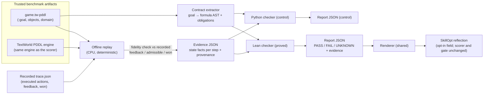

# Implementation Plan

Milestones, the next planned experiment, deferred work and open questions.
Current status and approvals: `STATE.md`. Decision history and reasons:
`DAILY_LOG.md`. Measurements: `EXPERIMENT_LOG.md`.

**Current priority (user decision 2026-10-20): the Lean-guided
contract-feedback prototype (Option B, independently specified task
contracts)** — see "Lean-guided prototype roadmap" below. The original
SkillOpt + ALFWorld baseline is operational (milestones 0–8). E1 (evaluation
noise) is supporting work that must not block the prototype; E3 (optimizer
replay) is deferred until the pipeline produces genuine reports.

## Milestones

| # | Milestone | Status | Evidence |
|---|---|---|---|
| 0 | Repository + paper inspection, paper/code differences | Done | `BASELINE_ARCHITECTURE.md` |
| 1 | Cluster inspection, deployment workflow, private settings | Done | `BASELINE_SETUP.md` |
| 2 | Envs, model, data installed; CPU tests | Done | jobs 64323909, 64332646; tests 64351262 (185 passed) |
| 3 | DeepSeek through SkillOpt's backend from a compute node | Done | job 64328962 |
| 4 | Qwen served on one A40 with loopback-only listeners | Done (vLLM 0.28.0) | job 64332934 (history: 64329002, 64330104, 64331018) |
| 5 | ALFWorld rollouts with valid actions, scores, preserved traces | Done | jobs 64333791 (1 episode), 64337548 (8 episodes) |
| 6 | Opt-in reasoning parser + trace instrumentation | Done | `8f739f7`; job 64336627 |
| 7 | One original SkillOpt optimization step incl. the gate | **Done** (operational; candidate rejected on a 12/18 tie) | job 64359024 (`12a153e`) |
| 8 | Review of the training run: logger audit, `train:0004` credit study, randomness inspection | **Done (offline)** | `EXPERIMENT_LOG.md` (offline analyses of 64359024) |
| 9 | Baseline protocol (supporting, in parallel): E1 evaluation noise → E2 assessment procedure; selection size, slow-update gating, reflection rounds, reasoning effort, seeds | Supporting; E1 planned, submission not yet requested | needs 7–8 |
| L0–L7 | **Lean-guided contract feedback (main track)** | **Planning done; L0 next** | roadmap below |

## First training smoke (milestone 7) — done

Ran as job 64359024 with `alfworld_smoke_strict_traced.yaml` (results:
`EXPERIMENT_LOG.md`). The plan below is kept as the record of what was
estimated beforehand; actual: 2.57 GPU-h (≈ $0.28), DeepSeek ≈ $0.008.

**Condition A: strict upstream parsing** (the user's planned first run).

- Command (after `research/deploy.sh` of the current HEAD):
  `STAGE=train research/submit.sh smoke HEAD -- --time=05:00:00`
- Config `configs/research/alfworld_smoke.yaml`: Qwen3.5-4B @ 851bf6e
  (thinking off, temperature 0.7, max_tokens 8000), optimizer `deepseek-flash`
  (`experiment.env`), 1 epoch × 1 step, 4 train tasks (`train:0017, 0036,
  0004, 0013`; seed 42), full 18-task selection gate, `env.workers` 8, edit
  budget 4, patch mode, slow update / meta at upstream defaults (no LLM calls
  at epoch 1), `eval_test: false`, `reasoning_parser: strict`,
  `trace_log: false`.
- Open choice: enabling `trace_log` for condition A needs a small
  `alfworld_smoke_strict_traced.yaml` (strict + `trace_log: true`). Traces do
  not affect the optimizer (the trainer never reads `trace.json`).
- Resources: 1 A40, 4 CPUs, 48 GB (one billing unit), 5 h limit.
- GPU-time **estimate:** vLLM startup ~4 min; selection baseline (18
  episodes, chunks 8/8/2) ~35–80 min; train (4) ~10–30 min; optimizer ~2–6
  min; candidate selection ~35–80 min (none on a skill-hash cache hit or
  with no patches). Total **~1.5–3.3 h**; billable ≤ 5 h × $0.108 ≈ **$0.54**,
  expected ~$0.20–0.36.
- DeepSeek **estimate** (not a cap), condition A: at most 4 call sites in
  one step (failure analyst, success analyst, final merge if both produce
  edits, ranking if more than 4 merged edits). Strict analyst inputs are
  ~8–11k tokens (4-failure minibatch, observed) and ~4–5k (successes);
  merge/ranking ~5k. Output ≤ 16,384 per call (thinking counts). At peak
  prices that is ≈ $0.09 if every output hit the cap; expected ~$0.01–0.03.
  Plus 2 tiny preflight calls.
- Retry layers (verified in code): backend `retries=3` × OpenAI SDK up to 2
  retries (no `max_retries` set) → ≤ 9 HTTP requests per call site, ≤ 36 per
  step. Failed requests are normally not billed; a JSON parse failure is not
  retried (no patch). There is no API-side spend cap. After the run, check
  `summary.json → token_summary` and `steps/step_0001/step_record.json → tokens`.

**Condition B: Qwen-compatible parsing** (prepared, not authorized):
`TRAIN_CONFIG=configs/research/alfworld_smoke_qwen_compat.yaml` (strict
smoke + `reasoning_parser: qwen_compat` + `trace_log: true`). Same GPU
estimate. Analyst inputs are ~84–112k tokens (failures) and ~26–34k
(successes), so ≈ $0.13 if every output hit the cap; expected ~$0.03–0.08.

Artifacts to inspect afterwards: `selection_eval_baseline/`,
`steps/step_0001/{rollout,patches,merged_patch.json,ranked_edits.json,candidate_skill.md,edit_apply_report.json,selection_eval,step_record.json}`,
`history.json`, `summary.json`, `skills/`, `billing.json`, `resource_usage.csv`.

## Deferred experiments (each a separately labeled condition for all arms)

| Idea | Why | Notes |
|---|---|---|
| Lower target output cap (< 8000) | 7/277 replies hit the cap; they dominate runtime and cause 5 fallbacks | changes model behavior and fallback rate |
| Per-step cap on recovered reasoning (condition B) | 6% of steps hold 35% of recovered text | changes the optimizer's input |
| More `env.workers` (e.g. one chunk for 18 selection episodes) | fewer lockstep chunks | changes upstream parallelism and per-chunk env seeds |
| Two vLLM replicas | free when a job already pays for 2 GPU units | needs a loopback proxy (an explicitly allowed listener) or a backend change; vLLM data parallelism still uses TCP rendezvous |
| DeepSeek reasoning effort "medium" | paper setting; we run the provider default ("high") | needs a flagged backend option |

## Lean-guided prototype roadmap (main track)

Goal: a minimal end-to-end pipeline that (1) takes task requirements from the
benchmark's trusted specification, (2) represents execution facts from
recorded ALFWorld trajectories, (3) checks them with a Lean 4 checker whose
correctness is proven, (4) emits PASS / FAIL / UNKNOWN diagnostics with
evidence, and (5) makes them available to SkillOpt's optimizer, without
changing the native scorer or the validation gate. First task family:
`look_at_obj_in_light`; the design is generic over ALFWorld's goal language
(all six task types use only `and`, `exists`, `not`, `=` and atoms;
`EXPERIMENT_LOG.md`, offline analyses).

### Trust boundary

| Layer | Source | Trusted because | Residual risk |
|---|---|---|---|
| Task requirement | `(:goal ...)` in each game's `game.tw-pddl` | it is the formula the scorer checks (`check_goal`) | our parser/translation (validated against `won`, below) |
| Environment state | ground facts from deterministic **offline replay** of the recorded `executed_action`s through TextWorld's PDDL engine (`_facts`, computed every step; `pddl.py:79`) | same engine that scored the episode; replay must reproduce recorded feedback, admissible commands and `won` at every step | Python fact mirror vs C++ state (validated: goal evaluated on replayed facts must equal the engine's `won` at every step); replay assumes determinism (no RNG found in `pddl.py`) |
| Observation-inferred state | parsing feedback text ("You arrive at...", "On the X, you see...") | not trusted: text hides closed-receptacle contents, `isOn`, co-location, and cooling's side effect | used only in a later study of what text alone supports, with UNKNOWN |
| Checker logic | Lean definitions + theorems | proofs checked by Lean's kernel | compiled executable trusts Lean's compiler; JSON glue unverified |
| Report wording | fixed renderer + glossary | deterministic, identical for C and D | wording effects on the optimizer (E3) |

**What Lean can guarantee** (if all theorems are proven with no `sorry` and
no axioms beyond Lean's standard three, checked by `#print axioms`): given
the evidence states and the goal formula, the verdict, each obligation's
status, the first step at which it held, the completing step and any
regression are exactly what the formal semantics says; the obligation list
is equivalent to the goal; with partial evidence (later), PASS/FAIL is
returned only when every completion of the evidence agrees, otherwise
UNKNOWN. **Lean cannot guarantee** that the evidence matches what really
happened, that our translation of the PDDL goal is faithful, that the goal
captures everything worth learning, that a failed obligation *caused* the
failure, or that the optimizer uses the report well. (Lean4Agent's
`trustExternalVerification` axiom, which concludes any predicate from any
tool result, is the kind of shortcut we must avoid.)

### Components

- **Reuse from Lean4Agent (MIT, `e6a78cb`), as patterns only:** Lean reading
  a JSON trace and printing a JSON verdict; Python calling a Lean executable
  by subprocess; a per-step digest layout (verdict, failed predicates,
  evidence). **Not reused:** its Mathlib dependency (Lean 4.20 + all of
  Mathlib), LLM-generated specs from the workflow's own steps (conflicts with
  independence), workflow-node mapping (fixed action sequences), LLM-judge
  injection, trust axioms.
- **New, generic over ALFWorld:** goal extractor (s-expression parser for
  the PDDL subset), offline replay + fidelity checker, evidence schema with
  interned symbols and provenance, Lean package `AlfContracts` (core Lean 4,
  no Mathlib; Batteries only if needed), Python reference checker, report
  schema + renderer, SkillOpt adapter hook.
- **Adapted in SkillOpt (opt-in, default off):** an ALFWorld adapter option
  `env.contract_feedback: none | spec_only | python | lean` that, before
  reflection on training rollouts, replays and checks each episode and
  attaches `contract_report` to the result row; one additive block in
  `fmt_minibatch_trajectories` that prints it under a labeled heading when
  present. With `none`, prompts must stay byte-identical (tested), and the
  scorer, gate, selection rollouts and edit rules are untouched.

### Contracts

- Obtained per game from the trusted `(:goal ...)`: the formula AST plus the
  object universe and types from `:objects`/`:init`. No skill text, no LLM.
- **Obligations** = the goal's top-level conjuncts, and inside an
  existential the body's conjuncts per candidate witness (e.g. for a heat
  task: "some apple is hot" and "that apple is in a countertop"). The
  decomposition is proven equivalent to the goal.
- A glossary maps predicates to fixed English ("isToggled ?l → the lamp has
  been switched on"), shared by both checkers and the spec-only control.

### Evidence

`{episode, gamefile_id, objects: [{id, name, types}], steps: [{t, action,
feedback, admissible_ok, state: [atom...], provenance: "env_replay",
fidelity: ok|mismatch}]}` with symbols interned to integers for fast kernel
evaluation. States after a fidelity mismatch are not trusted: obligations that
depend on them are UNKNOWN. **Hidden-information policy:** reports describe
the agent's trajectory and the goal; they never name locations of objects the
agent did not observe (the replayed state knows them).

### Lean package `AlfContracts` (sketch)

- Syntax: `Formula := atom | and | not | eq | exists (type) body`; ground
  `Atom`; `World := objects + true atoms` (closed world, as in PDDL).
- Semantics: `Holds : World → Valuation → Formula → Prop`; checker
  `eval : World → Formula → Bool`; theorem `eval w φ = true ↔ Holds w [] φ`.
- Trace level: `Trace := List World`; `firstSat`, `completingStep`,
  `regressions`, per-obligation status; theorems: minimality of `firstSat`,
  conjunction of obligations ↔ goal, verdict ↔ `Holds` at the final state.
- Later: `eval3` (Kleene, open-world existentials) for partial evidence, with
  soundness over all completions.
- Executable `alfcheck`: evidence JSON + contract JSON → report JSON. Optional
  certificate mode for audits: a generated `theorem ... := by decide` per
  episode, checked by the kernel.

### Python control

The same evidence, contract AST, obligation definitions and report schema,
implemented independently in Python (recursive evaluation, typed
existential enumeration) without proofs. Differential testing against Lean on
every episode; disagreements are bugs to explain. A separate spec-only
control renders the contract text without any trajectory checking.

### Milestones

| # | Deliverable | Acceptance test |
|---|---|---|
| L0 | Design note: contract semantics, report schema, trust boundary, hidden-info policy | reviewed with the user |
| L1 | Offline replay + evidence JSON for the 48 traced episodes (CPU job) | replay reproduces recorded feedback, admissible commands and `won` at every step (or marks UNKNOWN with reason) |
| L2 | Goal extractor + obligations + spec-only renderer | evaluating the extracted goal on replayed states equals the engine's `won` at **every step of all 48 episodes** |
| L3 | Python reference checker + report schema + renderer | golden reports for `train:0004` and `val:0001`; mutation tests (drop the pick-up, drop the toggle, reorder, add no-op actions) change diagnostics as expected |
| L4 | Lean toolchain on the cluster (approval needed) + `AlfContracts` with proofs + `alfcheck` | no `sorry`; `#print axioms` shows only Lean's standard axioms; Lean and Python reports identical on all 48 episodes |
| L5 | SkillOpt integration (opt-in), offline prompt rendering | `none` → byte-identical analyst prompts; scorer/gate diff guards pass; rendered `train:0004` prompt reviewed with the user (no API call) |
| L6 | E3 with genuine reports (paid, small) | per-arm edit statistics; needs approval |
| L7 | Small optimization runs: A vs spec-only vs C vs D (B separate) | design informed by E1/E2; needs approval |

### Uncertainties

1. **C vs D may be indistinguishable by construction (interpretation).** If
   both checkers are correct, their reports are identical, so the optimizer
   cannot behave differently. Lean's value then has to be shown as
   *assurance* (differential testing, injected-bug detection, sound UNKNOWN
   handling under partial evidence, proven faithfulness of the obligation
   decomposition), not as a higher score. The optimization question becomes
   "contract feedback vs reflection-only vs spec-only".
2. **Is goal-derived information enough?** Failures may need richer
   obligations (domain preconditions, admissibility, opened receptacles).
3. **Replay fidelity** (conditional effects, fact mirror) — tested in L1/L2.
4. **Lean toolchain** — not installed on the cluster; no local Lean runs
   (CLAUDE.md), so each Lean iteration is a CPU job.
5. **Information leakage** — replayed state is privileged; the policy above
   must hold, or gains may come from leaked task facts.
6. **Small reflection batches** (4 training episodes per step).

### First implementation steps (proposed)

1. **L0 design note** (local only): formal semantics, obligation and report
   schema, hidden-information policy, file layout — Python in
   `skillopt/envs/alfworld/contracts/` (imported only when the option is on),
   Lean in `lean/AlfContracts/`, tests in `tests/`.
2. **L1 + L2 in Python** (local code, then one small CPU job, no GPU/API):
   replay the 48 traced episodes, emit evidence JSON, extract goals, and run
   the two oracle tests (replay fidelity; goal evaluation = `won` at every
   step). This validates the trusted-evidence layer before any Lean work.
3. **Approval request:** install a pinned stable Lean toolchain (elan, user
   space in project storage, no Mathlib) with a CPU setup job, then L3/L4.

## Supporting and deferred experiments (not authorized)

### E1. Evaluation noise of the 18-task selection score (GPU, no API) — supporting

Kept as a small supporting study (user, 2026-10-20). It does not modify the
benchmark scorer or the validation gate and does not block the Lean track.

- **Question:** how often does the single-run strict gate accept a skill
  that is no better (here: identical)? For identical skills,
  P(accept) = (1 − P(tie)) / 2. Illustration (assumed values, not data):
  one task at p = 0.5 and 17 deterministic tasks already give 25%; five such
  tasks give 38%.
- **Design:** evaluate the unchanged initial skill on the same 18 selection
  tasks **3 more times**, with the existing rollout stage (no code change):
  `STAGE=rollout ROLLOUT_SPLIT=valid_seen ROLLOUT_EPISODES=18
  ROLLOUT_CFG_OPTIONS="env.trace_log=true" research/submit.sh smoke HEAD -- --time=02:00:00`,
  three separate jobs (each gets its own output directory, so the
  `results.jsonl` reuse in `adapter.rollout` cannot short-circuit a repeat).
  Together with the 64359024 baseline this gives 4 runs per task. Same model,
  sampling, cap, workers, parser and tasks as the training smoke.
- **Budget (estimate):** 3 × ~1.0–1.4 h on one A40 unit ≈ $0.33–0.46
  (≤ $0.65 at the limits); no DeepSeek calls.
- **Analysis (pre-specified):** per-task success counts out of 4; number of
  unstable tasks (0 < k < 4); variance of the 18-task total; simulated
  P(accept | identical skill) for the current gate and for alternatives (k
  repeats, margin, larger split); variability of steps, fallbacks and capped
  replies.
- **Decision rule:** if ≥ 3 tasks are unstable or the estimated
  P(accept | identical) ≥ 0.15, the one-run strict gate is not a usable
  criterion for comparing conditions, and the C-vs-D study needs the robust
  procedure below.
- **Limits:** 4 runs per task estimate each success rate coarsely; this does
  not measure optimizer (DeepSeek) variability.

### E2. Robust acceptance / assessment procedure (design, after E1)

Options, each a separately labeled protocol change applied to all arms:
(a) larger selection split (all 140 `valid_seen`; ~8× cost per evaluation);
(b) repeated paired evaluation of candidate and incumbent with a margin or
paired test (also removes the winner's-curse bias of a single cached
incumbent score); (c) common random numbers: an opt-in per-request vLLM
`seed` derived from (task, step, repeat), which couples the two skills'
sampling noise (exact reproducibility is still not guaranteed because the
Qwen3.5 attention backend is not batch-invariant); (d) for comparing
conditions, several independent optimization runs per condition and a
repeated, paired final evaluation on held-out tasks. A reasonable split:
keep the upstream gate inside optimization for fidelity, and use (d) for the
final comparison. Decision after E1.

### E3. Optimizer replay pilot — **deferred** (user, 2026-10-20)

Not before the contract pipeline produces genuine reports (milestone L5).
Then: replay recorded analyst prompts N times each with (i) the original
input, (ii) goal-specification-only text, (iii) the Python-checker report,
(iv) the Lean-checker report. Hand-constructed feedback is not used.

## Open methodology questions

1. **Selection split:** keep 18 (repo), materialize all 140 `valid_seen`
   (paper, an inference), or ask upstream (`BASELINE_ARCHITECTURE.md` §2a).
2. **Slow-update gating:** paper gated, code force-accepts.
3. **Reflection rounds:** paper up to 3, code 1 (multi-round never wired in).
4. **Batch size:** default 40 > 39 train tasks.
5. **Seeds and repeats:** an 18-task gate is noisy (E1, E2). The baseline
   is evaluated once and acceptance is a strict `>` on single runs
   (`BASELINE_ARCHITECTURE.md` §2g).
7. **Success-minibatch size:** a success group of one trajectory still yields
   up to L edits, although the analyst prompt asks for patterns common to
   multiple trajectories (`train:0004` case, `EXPERIMENT_LOG.md`).
6. **Reasoning channel:** whether condition B improves optimization at all
   (untested).

## Research conditions (user decision 2026-10-20; B–D not yet validated)

| | Condition | Optimizer input added | Compare against |
|---|---|---|---|
| A | strict-parser SkillOpt baseline | — | reproduced baseline |
| B | Qwen-compatible parser | agent's recovered explanations | A (a format fix, never credited to verification) |
| C | independently specified Python-contract feedback | contract reports | A/B under the same parser, and a specification-text-only control |
| D | equivalent Lean-contract feedback | the same reports, checked in Lean | C, with identical contracts and report content |

Contracts come from the benchmark's trusted task specification (the PDDL
goal in each `game.tw-pddl`), not from the skill. Example (from the
`train:0004` study; the first family of the roadmap above),
`look_at_obj_in_light(T)`:

- Obligations, all in one state: (G1) a DeskLamp is `isToggled`; (G2) the
  agent is at the lamp's receptacle location; (G3) the agent holds an object
  of type T. Not obligations: `examine`, order of toggle and pick-up.
- Report for `train:0004` (what a checker could say): PASS; G2 from step 1,
  G1 from step 2, G3 at step 4 (completing step); steps 0 and 3 changed no
  obligation; after step 3: G1 ✓ G2 ✓ G3 ✗.
- Report for failed `val:0001`: G1 never achieved; lamp never observed
  (UNKNOWN for G2's location); G3 achieved and undone repeatedly.
- Evidence source matters: state recovered from observation text is
  heuristic (needs PASS/FAIL/UNKNOWN), and ALFWorld's text hides some state
  (a second toggle still prints "You turn on"). Whether the environment can
  export ground-truth PDDL facts per step is an open question. Lean checks
  the logic, not the extraction.

## Future conditions

C (Python) and D (Lean) are now planned in "Lean-guided prototype roadmap"
(milestones L0–L7). Neither is a validated optimization condition yet.
